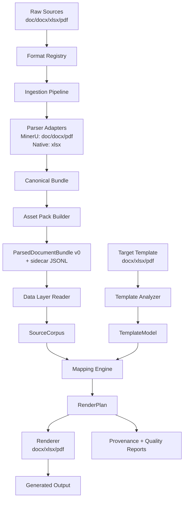

# DocTransAI Code Architecture

> **For agentic workers:** Current V1 runs in **DataProxy Upstream Mode**. You may import/call DataProxy to generate `ParsedDocumentBundle v0`, but you must never modify files under `/Users/paul/Coding/DataProxy`. If you find a DataProxy issue, report it to the project owner for upstream fixes.

> Standalone delivery rule: the `ingestion/` and `canonical/` packages are reserved for the later isolation phase. When that phase begins, follow `docs/2026-05-21-dataproxy-mainline-migration-map.md` before changing ingestion code.

**Goal:** Validate DocTransAI's template mapping and rendering workflow quickly by consuming DataProxy-produced `ParsedDocumentBundle v0`, while reserving clean package positions for later standalone delivery.

**Architecture:** In V1, raw files enter DataProxy, DataProxy produces `ParsedDocumentBundle v0`, and DocTransAI starts at `data_layer` before template mapping and rendering. Later, the reserved `ingestion/canonical/asset_pack` packages can replace DataProxy when standalone delivery becomes necessary.
Target mapping principles are defined separately in `docs/2026-05-21-generic-mapping-principles.md`: generic non-LLM mapping first, batch LLM resolution only for ambiguity, and no domain field packs in the core path.

**Tech Stack:** Python 3.12, JSON Schema, python-docx, openpyxl, Pillow, local Office conversion for legacy `.doc`, and a future PDF parser dependency such as PyMuPDF.

---

## 1. Format Scope

| Format | Role | V1 Handling |
| --- | --- | --- |
| `.doc` | Source input, legacy Word | MinerU document parser, matching DataProxy routing |
| `.docx` | Source input and output template | Source ingestion through MinerU; template analysis/rendering through native OOXML |
| `.xlsx` | Source input and output template | Native parser, table/cell/image extraction, renderer |
| `.pdf` | Source input, optional target/export format | Source ingestion through MinerU; scanned/OCR remediation remains quality-gated |

Explicitly out of V1 scope:

- `.ppt` / `.pptx`
- Image-only OCR as primary extraction
- VLM captioning or image semantic understanding
- DataProxy DB/API/search/agent runtime

## 2. Top-Level Code Layout

```text
src/doctransai/
  cli.py
  formats/
    registry.py
  upstream/
    dataproxy/
      policy.py
      runner.py
      issue_report.py
  ingestion/
    pipeline.py
    scanner.py
    conversion.py
    models.py
    parsers/
      mineru_document.py
      xlsx_native.py
      office_native.py
    asset_pack/
      builder.py
      manifest.py
      writers.py
      relationships.py
      diagnostics.py
      quality.py
      visual_inventory.py
      block_inventory.py
      spreadsheet_inventory.py
  canonical/
    models.py
    document.py
    section.py
    table.py
    sheet.py
    evidence.py
    visual.py
  data_layer/
    bundle_reader.py
    models.py
    schema_validation.py
  models/
    source.py
    source_instance.py
    template.py
    mapping.py
    render_plan.py
  source_model/
    adapter.py
    instances.py
  templates/
    models.py
    placeholders.py
    analyzers/
      docx.py
      xlsx.py
      pdf.py
  mapping/
    models.py
    image_mapper.py
    resolver.py
    planner.py
    type_inference.py
    structural_candidates.py
    constraint_checks.py
    agent_resolver.py
    orchestrator.py
  renderers/
    models.py
    docx.py
    xlsx.py
    pdf.py
    image_placement.py
  reports/
    conversion_report.py
    provenance_report.py
  validation/
    bundle_gate.py
    output_checker.py
```

## 3. Module Responsibilities

`formats`  
Owns supported extensions and routing keys. No parser, analyzer, or renderer should hard-code extension lists.

`upstream.dataproxy`  
Owns the current V1 integration boundary with DataProxy. It may import/call DataProxy but must never write to the DataProxy project. Any upstream defects are reported, not patched here.

`ingestion`  
Reserved for standalone delivery. It will own source-file parsing and production of `ParsedDocumentBundle v0` only after the V1 effect is validated.

`canonical`  
Reserved for standalone delivery. It will own normalized document facts before they become sidecar JSONL files: documents, sections, tables, sheets, cell ranges, evidence, and visual assets.

`ingestion.asset_pack`  
Owns writing `evidence_units.jsonl`, `table_units.jsonl`, `section_units.jsonl`, `source_manifest.jsonl`, `block_inventory.jsonl`, `sheets.jsonl`, `cell_ranges.jsonl`, `visual_asset_inventory.jsonl`, `diagnostics.jsonl`, reports, and `parsed_document_bundle.json`.

`data_layer`  
Owns reading and validating an existing bundle. It must remain consumer-side and should not contain parser logic.

`models` and `source_model`  
Own DocTransAI-owned source abstractions after bundle reading. `source_model.adapter` builds `SourceModel` from DataProxy bundle records. `source_model.instances` builds a read-only `SourceInstanceIndex` compatibility layer from `SourceModel`; it must not mutate `SourceModel` or replace the current `primary_record` planner path until that migration is explicitly enabled.

`templates`  
Owns template structure extraction for docx/xlsx/pdf: slots, repeated regions, table headers, form fields, and image placeholders.

`mapping`  
Owns mapping source evidence/cells/assets into template slots and producing a `RenderPlan`. The target architecture is generic: value-shape inference, structural candidate preparation, generic constraint checks, and only then optional LLM disambiguation.

`renderers`  
Owns writing output files from a `RenderPlan`. Renderers do not decide which value should fill a slot.

`reports` and `validation`  
Own traceability, unresolved slots, output checks, and quality gates.

## 4. DataProxy Policy

Current V1 policy:

- DocTransAI may import/call DataProxy as an upstream dependency.
- DocTransAI must not modify DataProxy source code.
- DataProxy defects must be reported to the project owner with file paths, observed behavior, and expected behavior.
- DocTransAI implementation should focus on modules after `ParsedDocumentBundle v0`: `data_layer`, `templates`, `mapping`, `renderers`, `reports`, and `validation`.

Later standalone migration should migrate/rewrite these capabilities into DocTransAI:

- File scanner and checksum generation.
- MinerU document parser adapter for `.doc`, `.docx`, and `.pdf`, matching DataProxy source-ingestion routing.
- `.xlsx` native parser including sheets, cell ranges, and embedded image anchors.
- Native OOXML helpers for docx template analysis/rendering and optional quality remediation, not as the primary source parser.
- Canonical models and normalizers.
- Asset-pack row builders.
- Visual asset inventory.
- Block inventory.
- Spreadsheet inventory.
- Diagnostics and quality summary.
- ParsedDocumentBundle manifest writer.

Do not migrate these DataProxy areas:

- Database exporters and ORM models.
- Alembic migrations.
- API service.
- Retrieval/search/vector stack.
- Agent runtime.
- OCR/VLM/image understanding enhancements.

## 5. Data Flow



## 6. V1 Implementation Order

1. **Format registry and upstream policy**  
   Done for `doc/docx/xlsx/pdf`. This prevents hard-coded extension drift.

2. **Data layer**
   Done for bundle reading and local schema validation.

3. **Source model adapter**
   Convert raw bundle sidecar records into DocTransAI-owned source/evidence/table/asset models.

4. **Template analyzers**
   Implement docx and xlsx first; PDF template support can start with form fields or page-level placement metadata.

5. **Mapping and RenderPlan**
   Build candidate records, resolve fields, map images, and emit auditable `RenderPlan`.

6. **Renderers and reports**
   Generate docx/xlsx/PDF outputs and provenance/conversion reports.

7. **Standalone migration**
   Only after V1 output quality is accepted, use `docs/2026-05-21-dataproxy-mainline-migration-map.md` to replace DataProxy upstream dependency.


## 7. Current State

Already present:

- `src/doctransai/formats/registry.py`
- `src/doctransai/upstream/dataproxy/policy.py`
- `src/doctransai/llm/client.py`
- `src/doctransai/ingestion/asset_pack/builder.py`
- `src/doctransai/ingestion/asset_pack/manifest.py`
- `src/doctransai/ingestion/asset_pack/writers.py`
- `src/doctransai/data_layer/bundle_reader.py`
- `src/doctransai/data_layer/schema_validation.py`
- `src/doctransai/source_model/adapter.py`
- `src/doctransai/templates/analyzers/p1b.py`
- `src/doctransai/mapping/agent_resolver.py`
- `src/doctransai/mapping/orchestrator.py`
- `src/doctransai/renderers/docx.py`
- `src/doctransai/renderers/xlsx.py`
- `src/doctransai/renderers/pdf.py`
- `src/doctransai/reports/conversion_report.py`
- `src/doctransai/reports/provenance_report.py`
- `src/doctransai/workflows/v1_conversion.py`
- `contracts/dataproxy/data_asset_pack_v0/*.schema.json`

Next code step:

- Replace the transitional field-specific mapping helpers with generic structural narrowing plus the new agent-resolver path, then improve real-template fidelity and output quality.
