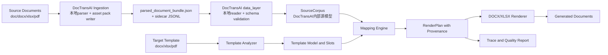

# DocTransAI V1 开发指导与实施计划

> **For agentic workers:** 当前 V1 采用 **DataProxy Upstream Mode**。可以导入/调用 DataProxy 生成 `ParsedDocumentBundle v0`，但禁止修改 `/Users/paul/Coding/DataProxy` 下的源码。发现 DataProxy 问题，只向项目负责人汇报，由负责人回到 DataProxy 修复。DocTransAI 当前主线只做读取 bundle 之后的模板、映射、渲染和报告模块。

**Goal:** 建立 DocTransAI V1 的主线开发边界和实施路线，使项目拥有自己的数据层入口，能够读取 `ParsedDocumentBundle v0` 结构化文档产物，并完成任意模板下的信息映射、文档生成和可追溯校验。

**Architecture:** DataProxy 当前负责源文档解析、质量门禁和 `ParsedDocumentBundle v0` 生产；DocTransAI 从 `doctransai.data_layer` 开始，负责模板理解、字段映射、渲染和报告。`ingestion/canonical/asset_pack` 目录先保留位置，等 V1 效果满意后再按 `docs/2026-05-21-dataproxy-mainline-migration-map.md` 做独立交付迁移。
`mapping` 的长期目标架构以 `docs/2026-05-21-generic-mapping-principles.md` 为准：非 LLM 层必须是零领域字段包、零固定模板假设的通用结构映射。

**Tech Stack:** Python 3.12, JSON Schema, python-docx, openpyxl, Pillow, 后续 PDF parser 依赖，后续可按需引入 LLM/agent 做模板槽位和字段映射推理。

---

## 1. 当前审计结论

DocTransAI 当前已具备第一版 Python 工程骨架，根目录主要包含：

- `pyproject.toml`、`src/doctransai/`、`tests/`：本项目代码、CLI、测试入口。
- `docs/2026-05-21-doctransai-code-architecture.md`：当前 Upstream Mode 与后续独立交付的代码架构。
- `contracts/dataproxy/data_asset_pack_v0/`：迁移进本项目的 DataProxy v0 schema 快照。
- `文件类型汇总/`：需求方提供的混乱原始资料库。
- `V1文档审核集/`：已筛选的 V1 输入、模板、参考成品和暂缓样本。
- `artifacts/dataproxy_fresh_probe_*/`：用 DataProxy fresh validation 生成的结构化验收产物。
- `docs/`：开发指导文档目录。

当前代码主线已经可以完成：

- 读取 `ParsedDocumentBundle v0`
- 适配为 `SourceModel`
- 分析 `docx/xlsx/pdf` 模板为 `TemplateModel`
- 生成 `RenderPlan`
- 输出 `docx/xlsx/pdf` 第一版渲染结果
- 输出 `conversion_report` 与 `provenance_report`

DataProxy 现在已经足够作为 V1 的上游结构化产物生成工具。2026-05-21 用 V1 的 4 个源文档重新跑 fresh bundle，结果为：

- `document_count`: 4
- `parse_error_count`: 0
- `evidence_count`: 17
- `block_count`: 72
- `table_count`: 2
- `section_count`: 3
- `sheet_count`: 1
- `cell_range_count`: 11
- `visual_asset_count`: 25
- `qa_seed_count`: 17
- `diagnostic_count`: 29

最新验证产物入口：

`/Users/paul/Coding/DocTransAI/artifacts/dataproxy_fresh_probe_20260521/parsed_document_bundle.json`

真实产物已用 DataProxy 的 schema 校验通过：

- `parsed_document_bundle.json`
- `block_inventory.jsonl`
- `sheets.jsonl`
- `cell_ranges.jsonl`
- `diagnostics.jsonl`
- `visual_asset_inventory.jsonl`
- `evidence_units.jsonl`
- `qa_seed_pack.jsonl`
- `data_quality_report.json`

## 2. DataProxy 数据层能力审计

本章所有 DataProxy 侧结论，当前都以本机 `/Users/paul/Coding/DataProxy` 工作树的 **`codex/backend-dev`** 分支只读观察为准。DocTransAI 只消费上游产物，不直接修改 DataProxy 源码。

### 2.1 作为本地迁移基线的部分

DocTransAI V1 当前只需要稳定消费 DataProxy fresh validation 旁路产物。当前已在本项目落地：

- `contracts/dataproxy/data_asset_pack_v0/*.schema.json`
- `src/doctransai/data_layer/schema_validation.py`
- `src/doctransai/data_layer/bundle_reader.py`
- `src/doctransai/data_layer/models.py`
- `tests/data_layer/test_bundle_reader.py`

DataProxy 侧仍可作为参考来源：

- `/Users/paul/Coding/DataProxy/src/dataproxy/data_assets/fresh_validation.py`
- `/Users/paul/Coding/DataProxy/scripts/validate_fresh_asset_pack.py`
- `/Users/paul/Coding/DataProxy/contracts/data_assets/v0/*.schema.json`

主链路迁移地图：

- `docs/2026-05-21-dataproxy-mainline-migration-map.md`

核心产物：

| 产物 | DocTransAI 用途 | 是否作为主输入 |
| --- | --- | --- |
| `parsed_document_bundle.json` | 总入口，定位所有组件、数量、能力、质量摘要 | 是 |
| `source_manifest.jsonl` | 源文档 ID、路径、校验和、类型 | 是 |
| `evidence_units.jsonl` | 可引用证据单元、文本、locator、asset_refs | 是 |
| `table_units.jsonl` | 表格结构、行列、表格身份 | 是 |
| `section_units.jsonl` | 章节级文本和定位 | 是 |
| `block_inventory.jsonl` | 源 block 顺序、类型、定位、关联 evidence/asset | 是 |
| `sheets.jsonl` | 工作表清单 | 是 |
| `cell_ranges.jsonl` | 单元格范围、表头、行数据、parser_signals | 是 |
| `visual_asset_inventory.jsonl` | 图片资产、来源、位置、checksum、证据关系 | 是 |
| `diagnostics.jsonl` | 质量问题统一诊断 | 是 |
| `qa_seed_pack.jsonl` | 上游证据回归测试种子 | 否，作为测试辅助 |
| `data_quality_report.json` | 数据质量摘要 | 是，作为 gate |
| `visual_quality_report.json` | 图片资产质量摘要 | 是，作为 gate |
| `qa_seed_quality_report.json` | QA 种子质量摘要 | 否，作为回归辅助 |

### 2.2 DataProxy 已覆盖的通用能力

DataProxy 已经可以承担以下通用数据管道职责：

- 多格式源文档解析入口：xlsx、doc/docx、pdf 路径由 DataProxy parser 路由处理。
- 统一 canonical bundle：document、section、table、sheet、cell_range、evidence。
- 统一 `ParsedDocumentBundle` 旁路交付入口。
- 源文档 checksum、source_path、document_id。
- 表格结构化：`rows`、`cells`、`header_rows`、`merged_cells`、`table_identity`。
- Excel sheet/cell range 清单：sheet、range、header_values、row_index、non_empty_columns。
- block 清单：保留原始 block 顺序、block_type、page_anchor、bbox、sheet/range、table/section/evidence/asset 关联。
- 图片资产清单：source_ref、asset_source、page_anchor、bbox、sheet/cell anchor、checksum。
- 图片与文本证据关系：精确关系 `related_evidence_ids` 和弱共页关系 `page_co_located_evidence_ids` 已拆开。
- 质量诊断：data quality、visual quality、quality gate residual 统一进入 `diagnostics.jsonl`。
- QA seed：可用于检查证据是否可被问答式回放，不作为 DocTransAI 业务主链路。

### 2.3 DataProxy 前置 9 项修复结论

项目启动前，已经先对 DataProxy 数据层做过一次前置审计，并完成了 9 项通用能力修补。当前可以视为：

- V0 旁路交付产物已经成型
- DocTransAI 可以直接建立在这套 fresh bundle 契约之上
- 老 DB exporter 仍不是完整 `ParsedDocumentBundle` 入口，这一点是有意保留的 V0 边界，不作为当前阻塞项

9 项修复结论如下：

| 序号 | 原问题 | 当前结论 |
| --- | --- | --- |
| 1 | 统一 `ParsedDocumentBundle` 还不完整 | 已完成 v0，新增 `parsed_document_bundle.json` 统一入口 |
| 2 | 缺少 Sheet / CellRange 清单导出 | 已完成，新增 `sheets.jsonl` / `cell_ranges.jsonl` |
| 3 | 缺少 BlockInventory | 已完成，新增 `block_inventory.jsonl` |
| 4 | native DOCX 定位偏弱 | 已完成结构锚点；仍不伪造页码 |
| 5 | 图片与文本证据关联不够强 | 已完成 `evidence / visual / block` 关系和上下文 preview |
| 6 | Evidence 到 Asset 双向链接没打通 | 已完成，`asset_refs` 与 `related_evidence_ids` 已打通 |
| 7 | 表格结构导出偏文本化 | 已完成 v0，补 `rows / cells / header_rows` |
| 8 | `parser_signals` 只剩布尔值 | 已完成，导出具体 `parser_signals` |
| 9 | 质量诊断不统一 | 已完成，新增 `diagnostics.jsonl` |

补充说明：

- `visual_asset_inventory.schema.json` 已支持弱共页字段，精确关联与弱关联已拆开。
- `parsed_document_bundle.json` 当前是 DataProxy fresh validation 旁路交付产物，不等于老数据库导出入口。

### 2.4 不应迁移或不应依赖的部分

以下能力不应在 V1 迁入 DocTransAI：

- DataProxy DB exporter：`src/dataproxy/data_assets/exporter.py` 当前不是完整 `ParsedDocumentBundle` 入口，只导出老的 data asset 子集。
- DataProxy 数据库模型、Alembic、PostgreSQL、Milvus、Haystack、检索服务。
- DataProxy API 服务和 agent runtime。
- OCR、VLM caption、图片内容理解、图表语义解析、embedding。
- DataProxy 内部 parser 的全部运行时依赖。需要的 `doc/docx/pdf -> MinerU` 文档解析能力、`xlsx -> native` 表格解析能力，应迁移或重写到 `src/doctransai/ingestion/`。

本项目要迁移的是“契约、消费方式、必要的本地 ingestion/canonical/asset_pack 生产链路”，不是整套 DataProxy 运行时。

### 2.5 Observe 轮反馈给 DataProxy 的问题清单

基于 DocTransAI 第二轮 `observe` 批量验证，当前更准确的口径不是“把所有下游不满都直接上推成 DataProxy 漏洞”，而是按照 **DataProxy 是通用数据管道，不是为 DocTransAI 定制的数据准备器** 这个定位重审。

补充说明：

- 当前这轮判断仍基于 `/Users/paul/Coding/DataProxy` 的 `codex/backend-dev` 分支只读观察。
- `quality_gate.py` 与 `structure_audit.py` 的相关实现当前位于 `dataproxy/ingestion/`，不是 `dataproxy/data_assets/`。

#### 2.5.1 Word/docx 表格结构已经有了，但还没有提升到 field/value 级 evidence 层

涉及 source：

- `环资公司安全检查记录表（2022.3.7 核心区纵二路东段、纵三路）.docx`
- `附件1：广西路桥工程集团有限公司市政分公司2022年第一季度安全标准化检查记录表.docx`

当前更准确的判断是：

- DataProxy **并不是没有表格结构化能力**
- 当前旁路交付层已经能导出：
  - `rows`
  - `header_rows`
  - `cells`
  - `row_count`
  - `column_count`
  - `merged_cells`

真正还没做成的是：**把这些表格结构进一步提升成 row/cell/field 级的一等 evidence/value 层**。

这对 DocTransAI 很重要，但站在通用数据管道定位下，不一定要求默认把所有 Word 表格都炸成字段证据。

当前缺的是例如：

- 表头字段
- 表格行/单元格
- 问题项
- 日期字段
- 编号字段
- 人员/单位字段

直接症状：

- `整改单编号&时间戳 -> missing_value`
- `检查时间 / 整改时间 / 复查时间 -> low_confidence`
- `安全责任区域 -> missing_value`

因此这条不应直接定性为“上游没有结构化能力”或“主链已坏”，而应定性为：

- **Word/docx 表格结构已经保留**
- **field/value 级 evidence promotion 仍是可选增强能力缺口**

建议：

- 对 `mineru` 的表格型 Word/docx 源补 row/cell/field 级 evidence/value promotion。

#### 2.5.2 `table_density_mismatch` 已被诊断，但还没有形成更强的结构化交付产物

两个表格型 docx source 都出现：

- `initial_issues` 有 `table_density_mismatch`
- `residual_issues` 仍保留 `table_density_mismatch`

这说明 DataProxy 已识别问题，但当前只停留在诊断层，尚未转化为更强的 delivery/sidecar 产物。

这条应认定为：

- **通用数据管道能力缺口**
- 属于 **delivery / sidecar 层增强**

建议：

- 将 `table_density_mismatch` 从“诊断发现”推进到：
  - 更细的 row/cell 视图导出
  - 或更强的结构化 sidecar 产物
- 如果暂时无法自动修复，至少导出更明确的 diagnostic/sidecar，告诉下游是：
  - 行拆分失败
  - 列对齐失败
  - 标题识别失败
  - 或建议 fallback 到 native table extract

#### 2.5.3 Word 图片资产链路当前不能直接上推为上游漏洞，必须先拆因

当前三个 observe source 的 `SourceModel` 观测结果都是：

- `image_assets_linked_by_source_path = 0`

DocTransAI 侧当前直接症状是：

- `隐患照片 -> missing_asset`
- `整改照片 -> missing_asset`
- `复查照片 -> missing_asset`

但 DataProxy 当前已经有：

- 图片资产清单能力：`visual_inventory.py`
- `missing_image_asset_reference` 检测与修复路由：`ingestion/quality_gate.py`

因此“当前不可用”至少可能有三类来源：

1. 原文档本来就无图
2. parser / remediation 对某个 source family 还没抽出来
3. DocTransAI 当前消费链并没有命中对应 visual asset / asset_refs

因此这条目前**不能直接算成上游漏洞**，更准确的动作是：

- 先做 **per-source differential audit**
- 再区分：
  - `no_source_image`
  - `image_extract_failed`
  - `missing_image_asset_reference`
  - `downstream_not_consumed`

#### 2.5.4 `.doc` 列表正文只有页面级 evidence，属于通用 evidence granularity 缺口

涉及 source：

- `关于3月份安全生产大检查情况的通报.doc`

当前只形成：

- `1` 条页面级/section 级 record

这对通知、通报、规范、制度、公告类文档都偏粗，至少还缺：

- 段落编号
- 列表项
- 列表项内的问题描述、责任主体、时间候选

当前虽然已有：

- `list_flattening` 诊断/修复基础能力（位于 `ingestion/structure_audit.py`）

但“列表项 / 条款级 evidence promotion” 还没有做完整。

因此这条应认定为：

- **通用数据管道能力缺口**
- 属于 **generic evidence granularity gap**

建议：

- 对正文通报/列表型 `.doc` 源补 section/list-item/paragraph-item 粒度拆分。

#### 2.5.5 重审后的 4 条结论

1. Word/docx 表格太粗  
   不应直接判为上游漏洞。更准确地说，是 **field/value 级 evidence 还没做成可选增强能力**。

2. `table_density_mismatch` 只有诊断没有更强产物  
   这是 **通用数据管道能力缺口**，属于 delivery / sidecar 层增强。

3. Word 图片资产链路不可用  
   现在 **不能直接上推**，必须先做 source-by-source differential audit。

4. `.doc` 列表正文只有 1 条页面级 record  
   这是 **通用数据管道能力缺口**，属于 evidence granularity 问题。

#### 2.5.6 需要先确认源文档本体、不能直接算成 DataProxy bug 的项

以下字段暂时不能直接归因为 DataProxy 缺陷，需要先确认原始文档是不是本来就没有：

- `检查时间 / 整改时间 / 复查时间`
- `安全责任区域`
- `隐患照片 / 整改照片 / 复查照片`

如果原文档确实有这些信息而 bundle 没拆出来，那就是 DataProxy 问题；如果原文档本来空白或无图，则 DocTransAI 保持 unresolved 是正确行为。

#### 2.5.7 具体 source 的 differential audit（2026-05-21 observe rerun）

为避免继续停留在抽象层，已基于 `codex/backend-dev` 分支对 3 个 observe source 重新跑了一轮 fresh validation，产物目录为：

- `artifacts/dataproxy_observe_diff_audit_20260521/`

本轮关键结果：

- `document_count = 3`
- `visual_asset_count = 0`
- `table_row_count = 26`
- `table_cell_count = 159`
- `diagnostic_count = 4`

说明：

- **表格粒度 sidecar 已经真正产出**
- **图片资产在这 3 个 observe source 上当前仍为 0**

按 source 拆因如下。

1. `Word表格源 / 环资公司安全检查记录表（2022.3.7 核心区纵二路东段、纵三路）.docx`
   - fresh validation 结果：
     - `table_rows = 11`
     - `table_cells = 100`
     - `evidence_count = 1`
     - `image_block_count = 0`
     - `visual_asset_count = 0`
     - `diagnostics` 仅有 `table_density_mismatch`
   - 源文档本体审计：
     - `docx` 内嵌媒体文件 `13` 个
   - 结论：
     - 该 source 上 **表格粒度增强已生效**
     - 但 **图片链路对这个具体 source 仍然存在上游缺口**
     - 因为源文档明明有图，而本轮既没有 visual asset，也没有触发 `missing_image_asset_reference`/image remediation 动作

2. `Word正文列表源 / 关于3月份安全生产大检查情况的通报.doc`
   - fresh validation 结果：
     - `evidence_count = 1`
     - `section_count = 1`
     - `visual_asset_count = 0`
     - 无 `list_flattening`、无图片类 diagnostics
   - 源文档本体审计：
     - 经 `soffice` 转 `docx` 后可见内嵌媒体文件 `4` 个
   - 结论：
     - 该 source 上 **列表/条款粒度增强没有体现在当前产物里**，仍只有页面/section 级 evidence
     - 同时源文档很可能含图，但本轮未形成 visual asset
     - 这是当前最值得继续追踪的 `.doc` 具体样本

3. `复杂检查记录源 / 附件1：广西路桥工程集团有限公司市政分公司2022年第一季度安全标准化检查记录表.docx`
   - fresh validation 结果：
     - `table_rows = 15`
     - `table_cells = 59`
     - `evidence_count = 3`
     - `visual_asset_count = 0`
     - `diagnostics` 仍为 `table_density_mismatch`
   - 源文档本体审计：
     - `docx` 内嵌媒体文件 `0` 个
   - 结论：
     - 该 source 上 **图片缺失不能上推成上游漏洞**，因为原文档本来就无图
     - 当前主问题仍是 `table_density_mismatch` 与 field/value promotion 不足

#### 2.5.8 当前边界更新：`table_rows/table_cells` 已被 DocTransAI 消费

本小节最初记录的是一个过渡状态：DataProxy 已经补出 `table_rows.jsonl` / `table_cells.jsonl`，但 DocTransAI 当时尚未消费。2026-05-25 复核后，该结论已经更新。

当前状态：

- `src/doctransai/data_layer/models.py` 已暴露 `SourceCorpus.table_rows` 与 `SourceCorpus.table_cells`。
- `src/doctransai/source_model/adapter.py` 已将它们适配为 `table_row_records` 与 `table_cell_records`，并进入 `SourceModel.records`。
- 表格行级记录会携带 `row_text`，单元格级记录会按 `header_value` 形成可候选的 `SourceValue`。

用科技成果 PDF 样本 bundle 复核：

- `evidence_units = 35`
- `table_units = 12`
- `table_rows = 269`
- `table_cells = 2359`
- `source_model.records = 2675`

#### 2.5.9 2026-05-22 图片主链修复后的 DocTransAI 消费状态

本轮确认了一个真实 DataProxy 主链适配 bug：MinerU `content_list.json` 中已经存在 `type=image` 与 `img_path`，但无 caption 图片曾在质量门禁前被过滤，导致 `ParsedBlock`、`block_inventory`、`visual_asset_inventory` 全链路失明。该问题已由 DataProxy 侧修复。

DocTransAI 用修复后的 fresh bundle 做了验证：

- `visual_asset_count = 4`
- `block_count = 32`
- 图片进入 `visual_asset_inventory.jsonl`，`asset_source = mineru`
- 图片块进入 `block_inventory.jsonl`，保留 `asset_id / order_index / page_anchor`
- 当前诊断只剩正常的 `weak_caption`

DocTransAI 侧已补齐消费逻辑：

- `SourceImageAsset` 保留 `document_id / source_path / asset_source / page_anchor / bbox / block_id / order_index`
- 从 `block_inventory` 为图片资产补 `nearby_text_before / nearby_text_after / nearby_evidence_ids`
- agent 图片候选包暴露图片邻近文本和块顺序，避免只给裸 `asset_id/source_ref`
- 非表格文档不再因为 `None == None` 被误判成 `same_record_row`
- conversion report 支持 provenance locator 中的 list/dict 嵌套值

当前已验证的效果：

- `关于3月份安全生产大检查情况的通报.doc` -> `安全隐患整改通单（项目）.docx`
- agent 已能从 4 张图片中选择附件里的 `二工区围挡未及时封闭` 图片，而不是前面的检查基本情况图片
- render diagnostics 为空

仍需反馈/确认的边界：

- DataProxy fresh artifact pack 的图片自包含镜像与 stale `source_ref` 修复已在上游完成，DocTransAI 继续按 bundle 相对路径消费，不复制 DataProxy 运行时缓存。
- DocTransAI 已支持把一个可重复图片 slot 展开为多张图片。关键口径是：模板分析层只标记可靠的 `multi_value_allowed` / media group 约束，agent 根据 source context 和模板上下文决定具体放几张，`RenderPlan` 只执行 agent 返回的 `candidate_ids`，不再提前替 agent 猜容量。

## 3. DocTransAI 功能需求审计

### 3.1 业务目标

DocTransAI 要解决的是：同一批源文档信息，需要面向不同对象、不同模板、不同格式，进行内容抽取、合并、重组、写入和排版。

正确理解不是“针对某个固定隐患事项模板开发”，而是：

1. 给定任意源文档集合。
2. 由结构化管道生成 `ParsedDocumentBundle v0`，当前可用 DataProxy 作为参考实现。
3. 给定任意目标模板。
4. DocTransAI 理解模板槽位和版式约束。
5. DocTransAI 将源信息映射到模板槽位。
6. DocTransAI 生成新的 docx/xlsx 文档，或按计划导出/生成 PDF。
7. 输出可追溯报告，说明每个值来自哪个 evidence/table/cell/asset。

### 3.2 V1 样本范围

Source：

- `V1文档审核集/01_被转换文档_Source/01_结构化台账源/安全检查台账.xlsx`
- `V1文档审核集/01_被转换文档_Source/02_Word表格源/环资公司安全检查记录表（2022.3.7 核心区纵二路东段、纵三路）.docx`
- `V1文档审核集/01_被转换文档_Source/03_Word正文列表源/关于3月份安全生产大检查情况的通报.doc`
- `V1文档审核集/01_被转换文档_Source/04_复杂检查记录源/附件1：广西路桥工程集团有限公司市政分公司2022年第一季度安全标准化检查记录表.docx`

Template：

- `安全隐患整改记录单.docx`
- `安全隐患整改通单（项目）.docx`
- `质量安全检查处罚通知单（分公司）.docx`
- `安全检查台账模版.xlsx`

Reference：

- `分公司质安隐患整改反馈单2022.3.21.doc`
- `质安隐患整改五定表2022.3.21.doc`

Deferred：

- 扫描/手写 PDF。
- 第三方长报告。

### 3.3 模板结构审计

V1 的 docx 模板有显式 `{字段名}` 占位符，适合作为第一阶段模板理解目标。

`安全隐患整改记录单.docx` 占位符 22 个：

- `{整改单编号&时间戳}`
- `{项目名称}`
- `{责任单位}`
- `{检查部位}`
- `{隐患类型}`
- `{隐患等级}`
- `{检查人}`
- `{检查时间}`
- `{隐患描述}`
- `{隐患照片}`
- `{整改要求}`
- `{整改期限}`
- `{安全责任区域}`
- `{整改责任人}`
- `{责任单位负责人}`
- `{整改时间}`
- `{整改描述}`
- `{整改照片}`
- `{复查人}`
- `{复查时间}`
- `{复查描述}`
- `{复查照片}`

`安全隐患整改通单（项目）.docx` 占位符 6 个：

- `{隐患照片}`
- `{隐患描述}`
- `{责任单位}`
- `{整改要求}`
- `{检查人}`
- `{整改责任人}`

`质量安全检查处罚通知单（分公司）.docx` 占位符 6 个：

- `{隐患照片}`
- `{责任单位}`
- `{责任单位负责人}`
- `{隐患描述}`
- `{手机号}`
- `{人员姓名}`

`安全检查台账模版.xlsx` 更像带示例数据的输出表，不是显式占位符模板。V1 应把它当作“表头驱动的行追加/行替换模板”，而不是 placeholder 模板。

## 4. 边界划分

### 4.1 DataProxy Upstream Mode 与后续迁移

当前 V1 不迁移 DataProxy 主链路代码，先复用 DataProxy 已完成能力：

1. **允许导入/调用**  
   DocTransAI 可以通过 `src/doctransai/upstream/dataproxy/` 调用 DataProxy 生成 bundle。

2. **禁止修改上游源码**  
   不允许编辑 `/Users/paul/Coding/DataProxy` 下的任何源码。发现问题记录并汇报。

3. **DocTransAI 当前主线**  
   从 `parsed_document_bundle.json` 开始，完成 source model、template model、mapping、RenderPlan、renderer、report。

后续独立交付时，再按三层迁移：

1. **契约迁移**  
   在 DocTransAI 中保存 DataProxy v0 schema 快照，用于校验 bundle。当前路径：
   - `contracts/dataproxy/data_asset_pack_v0/*.schema.json`

2. **产物消费迁移**  
   DocTransAI 自己实现 bundle reader，读取 `parsed_document_bundle.json`，解析侧车 JSONL，并转换为 DocTransAI 内部模型。当前入口：
   - `doctransai.data_layer.read_parsed_document_bundle`

3. **命令封装迁移**  
   后续可封装 `doctransai ingest`，但要分清两种模式：本地 parser 未迁移前，命令可临时调用外部 DataProxy 生成 bundle；一旦进入发布版，应优先把稳定 parser/asset pack 逻辑迁入 DocTransAI 或做成独立 SDK 依赖。业务链路不得直接依赖 `/Users/paul/Coding/DataProxy`。

应复用的数据概念：

- `document_id`
- `source_path`
- `source_checksum`
- `evidence_id`
- `locator`
- `asset_refs`
- `related_evidence_ids`
- `page_co_located_evidence_ids`
- `table_json.rows/cells/header_rows/merged_cells`
- `sheet_name`
- `cell_range`
- `page_anchor`
- `bbox`
- `parser_signals`
- `diagnostics`

### 4.2 Generic Mapping Constraint

当前仓库里已经有一版为了快速验证而写出的 V1 mapping 规则，但它不是最终架构。后续演进必须满足：

- 非 LLM 映射层不依赖领域字段包。
- 非 LLM 映射层不依赖固定模板字段名。
- LLM 只处理歧义决策，不替代 `SourceModel` / `TemplateModel` / 通用结构整理与约束检查。

详细原则见：

- `docs/2026-05-21-generic-mapping-principles.md`

### 4.3 DocTransAI 自身必须构建

DocTransAI 自身必须构建以下能力：

1. **项目工程骨架**
   - Python 包结构
   - 测试目录
   - CLI
   - 配置
   - 合同快照或合同路径配置

2. **上游 bundle 适配层**
   - manifest 加载
   - JSONL 加载
   - schema 校验
   - 路径解析
   - 诊断 gate
   - 转换为 DocTransAI 内部模型

3. **内部标准模型**
   - `SourceDocument`
   - `SourceEvidence`
   - `SourceTable`
   - `SourceSheet`
   - `SourceCellRange`
   - `VisualAsset`
   - `Provenance`
   - `QualityDiagnostic`

4. **模板分析**
   - docx 段落、run、表格、单元格、图片占位符识别
   - xlsx sheet、表头、示例行、样式、图片槽位识别
   - placeholder 模式：`{字段名}`
   - 表头驱动模式：无占位符，按列名填充
   - 重复区域模式：一条源记录生成一份文档或一行表格

5. **字段语义与映射**
   - 通用类型推断
   - 通用结构整理
   - 通用候选约束检查
   - 通用高置信规则收敛
   - LLM 只处理歧义项
   - 多源冲突处理
   - 多条记录拆分
   - 缺失字段保留 unresolved
   - 图片资产映射

6. **渲染计划**
   - 先生成 `RenderPlan`，不要直接写文档
   - 每个填充值保留 provenance
   - 每个图片保留 asset_id、source_ref、placement intent
   - 每个未解决槽位保留原因

7. **文档生成**
   - docx 保留模板样式和表格结构
   - xlsx 保留表头、列宽、行高、格式
   - 图片按模板槽位或表格列插入
   - 不做图片理解，只做资产插入和版式调整

8. **输出校验**
   - 模板槽位是否全部处理
   - 输出文件是否可打开
   - 文本是否写入正确位置
   - 图片文件是否存在且写入
   - provenance 是否完整
   - 与 reference 做人工或半自动比对

## 5. 总体架构



核心原则：

- DocTransAI 业务运行时只依赖本地 `doctransai.data_layer`，不直接 import DataProxy。
- DataProxy 在当前阶段只作为迁移参考实现，用来校准“源文档里有什么、在哪里、质量如何”。
- DocTransAI 负责“模板要什么、从哪里取、如何组织、怎么排版”。
- LLM/agent 可以辅助模板理解和字段映射，但不能绕过 `RenderPlan` 和 provenance。
- 图片不做内容理解。图片只作为 `VisualAsset`，按模板 slot 和映射关系插入。

## 6. 推荐工程结构

建议从空工程骨架开始：

```text
DocTransAI/
  pyproject.toml
  README.md
  contracts/
    dataproxy/
      data_asset_pack_v0/
  src/
    doctransai/
      __init__.py
      cli.py
      formats/
        registry.py
      ingestion/
        pipeline.py
        scanner.py
        conversion.py
        models.py
        parsers/
          mineru_document.py
          xlsx_native.py
          office_native.py
        asset_pack/
          builder.py
          manifest.py
          writers.py
          diagnostics.py
          visual_inventory.py
      canonical/
        models.py
        evidence.py
        table.py
        sheet.py
        visual.py
      data_layer/
        __init__.py
        bundle_reader.py
        models.py
        schema_validation.py
      models/
        source.py
        template.py
        mapping.py
        render_plan.py
        diagnostics.py
      templates/
        docx.py
        xlsx.py
        pdf.py
        placeholders.py
        slot_inference.py
      mapping/
        image_mapper.py
        resolver.py
        planner.py
        type_inference.py
        structural_candidates.py
        constraint_checks.py
        agent_resolver.py
        orchestrator.py
      renderers/
        docx.py
        xlsx.py
        pdf.py
        image_placement.py
      validation/
        bundle_validator.py
        output_checker.py
        trace_report.py
  tests/
    fixtures/
    data_layer/
    templates/
    mapping/
    renderers/
    validation/
```

### 6.1 文件职责

| 文件 | 职责 |
| --- | --- |
| `contracts/dataproxy/data_asset_pack_v0/*.schema.json` | 本项目内置的 DataProxy v0 契约快照 |
| `src/doctransai/formats/registry.py` | 统一登记 `doc/docx/xlsx/pdf` 的 parser/analyzer/renderer 路由 |
| `src/doctransai/ingestion/pipeline.py` | 本项目自己的源文档解析和 asset pack 生产入口 |
| `src/doctransai/ingestion/parsers/mineru_document.py` | `.doc/.docx/.pdf` 统一 MinerU 文档解析适配，匹配 DataProxy 主路由 |
| `src/doctransai/ingestion/parsers/xlsx_native.py` | Excel 文档原生解析、sheet/cell/image anchor 抽取 |
| `src/doctransai/ingestion/parsers/office_native.py` | docx 模板分析、渲染、质量补抽所需的原生 OOXML 辅助，不作为源文档主 parser |
| `src/doctransai/ingestion/asset_pack/*.py` | 生成 `ParsedDocumentBundle v0` 和各类 sidecar JSONL |
| `src/doctransai/canonical/*.py` | 文档、章节、表格、单元格、证据、图片资产的本地规范化模型 |
| `src/doctransai/data_layer/bundle_reader.py` | 读取 `parsed_document_bundle.json`，加载侧车文件，转换为 `SourceCorpus` |
| `src/doctransai/data_layer/schema_validation.py` | 本地 JSON Schema 校验，不依赖 DataProxy 包 |
| `src/doctransai/data_layer/models.py` | `SourceCorpus`、`ComponentFile` 等轻量源数据模型 |
| `src/doctransai/models/source.py` | 源文档、证据、表格、图片、定位模型 |
| `src/doctransai/models/template.py` | 模板、槽位、重复区域、图片槽位模型 |
| `src/doctransai/models/render_plan.py` | 渲染计划、填充值、图片放置、provenance |
| `src/doctransai/templates/analyzers/docx.py` | 解析 docx 模板中的文字槽位、表格槽位、图片槽位 |
| `src/doctransai/templates/analyzers/xlsx.py` | 解析 xlsx 模板中的表头、示例行、样式和输出区域 |
| `src/doctransai/templates/analyzers/pdf.py` | 解析 PDF 表单字段或页面级放置元数据 |
| `src/doctransai/mapping/image_mapper.py` | 通用图片候选生成 |
| `src/doctransai/mapping/resolver.py` | 通用冲突解决与 unresolved 输出 |
| `src/doctransai/mapping/planner.py` | 生成 `RenderPlan`，当前仍含少量 V1 过渡逻辑 |
| `src/doctransai/mapping/type_inference.py` | 通用值类型推断 |
| `src/doctransai/mapping/structural_candidates.py` | 通用结构候选整理 |
| `src/doctransai/mapping/constraint_checks.py` | 通用约束检查 |
| `src/doctransai/mapping/agent_resolver.py` | 仅处理歧义 slot 的 LLM 决策 |
| `src/doctransai/mapping/orchestrator.py` | 组织 structural -> rule -> agent -> plan |
| `src/doctransai/renderers/docx.py` | 写 docx，保持模板样式 |
| `src/doctransai/renderers/xlsx.py` | 写 xlsx，保持表头和样式 |
| `src/doctransai/renderers/pdf.py` | PDF 表单/导出型输出 |
| `src/doctransai/renderers/image_placement.py` | 图片尺寸、插入位置、缩放策略 |
| `src/doctransai/validation/output_checker.py` | 输出文件结构校验 |
| `src/doctransai/validation/trace_report.py` | 输出 provenance 报告 |

## 7. 分阶段实施计划

### Phase 0: 工程骨架

目标：把 DocTransAI 从资料目录变成可测试 Python 工程。

当前状态：已完成第一版。

已完成：

- 新建 `pyproject.toml`。
- 建立 `src/doctransai/`。
- 建立 `tests/`。
- 配置 pytest。
- 增加最小 CLI：`doctransai --help`。

验收：

- `uv run pytest` 能运行。
- `uv run doctransai --help` 能显示命令。

### Phase 1: Source Bundle Reader

目标：稳定读取 `ParsedDocumentBundle v0`，并保持 DocTransAI 与 DataProxy 运行时隔离。

当前状态：已完成最小可用切片。

已完成：

- 迁移 v0 schema 快照到 `contracts/dataproxy/data_asset_pack_v0/`。
- 实现 manifest 加载。
- 实现 JSONL 组件加载。
- 实现 schema 校验。
- 实现组件路径解析。
- 实现 report 路径解析。
- 输出 `SourceCorpus` 和 `ComponentFile`。

后续补强：

- 将 raw records 进一步转换为强类型 `SourceDocument`、`SourceEvidence`、`SourceTable`、`VisualAsset`。
- 读取真实 V1 artifact 的精简 fixture，覆盖 evidence/table/cell/asset。
- 增加 diagnostics gate。

测试：

- fixture 使用人工构造的最小 bundle，避免测试绑定真实业务文档；后续可增加脱敏真实 fixture。
- 校验 4 个 source document。
- 校验 17 条 evidence。
- 校验 25 个 visual asset。
- 校验 `qa_seed_pack` 可读但不进入核心模型。

验收：

- 能输出 `SourceCorpus`。
- 所有 source model 都有 provenance。
- 遇到 schema 错误能明确报错。

### Phase Later: 本地 Ingestion 与 Asset Pack 生产链路

目标：在 V1 效果满意后，DocTransAI 自己从 `doc/docx/xlsx/pdf` 生成 `ParsedDocumentBundle v0`，替代 DataProxy upstream 依赖。

当前状态：已完成格式注册骨架和最小 asset pack writer；下一步不是单独迁 parser，而是先迁 DataProxy fresh-validation 主链路骨架。

任务：

- 迁移 `run_fresh_asset_pack_validation` 的本地 orchestration 骨架。
- 统一格式注册和 parser 路由。
- 迁移或重写 `.doc/.docx/.pdf` 统一 MinerU 文档解析适配。
- 迁移或重写 `.xlsx` 原生解析、cell range 和图片 anchor 抽取。
- 迁移质量门禁和 remediation 钩子；扫描/OCR PDF 不在 V1 强行理解，但必须进入 diagnostics。
- 实现 `canonical` 规范化模型。
- 实现 asset pack writers，写出 `parsed_document_bundle.json` 和 sidecar JSONL。最小 writer 已完成，后续需要接入真实 parser 输出。

验收：

- 独立交付阶段才要求不 import DataProxy。
- 给定一个最小 xlsx/docx/pdf fixture，能写出 bundle 并被 `data_layer` 读回。
- 输出 bundle 通过本项目本地 schema 校验。

### Phase 3: 模板分析

目标：识别 V1 docx/xlsx/pdf 模板中的 slot。

任务：

- docx placeholder 提取，支持段落、表格单元格、run 分裂占位符。
- docx 图片 slot 识别，例如 `{隐患照片}`。
- xlsx 表头驱动模板识别。
- pdf 表单字段或页面级放置元数据识别。
- 输出 `TemplateModel`。

测试：

- `安全隐患整改记录单.docx` 应识别 22 个 slot。
- `安全隐患整改通单（项目）.docx` 应识别 6 个 slot。
- `质量安全检查处罚通知单（分公司）.docx` 应识别 6 个 slot。
- `安全检查台账模版.xlsx` 应识别 Sheet0 表头和示例行区域。

验收：

- 每个 slot 有位置、类型、原始文本、上下文。
- xlsx 能识别输出列名和行模板。

### Phase 4: V1 字段候选与映射

目标：把 bundle evidence 转换成模板可用字段。

当前状态：已完成一版可运行 mapping 主线，并已接入可选 `agent_resolver`。本阶段不再建设“安全隐患字段包”或任何固定领域字段包；业务字段包只能作为未来可插拔增强，不能进入 V1 默认主链。

任务：

- 从 `cell_ranges` 提取行级记录。
- 从 `table_units/table_rows/table_cells` 提取表格记录、行级事实和单元格级事实。
- 从 `section_units/evidence_units` 提取正文事实。
- 图片根据 `visual_asset_inventory`、`block_inventory`、邻近文本和 evidence 关系形成图片候选。
- 输出通用候选、置信度、证据来源、转换方式。
- 对低置信、歧义、自动生成和非精确标签匹配交给 agent 批量语义裁决。

验收：

- 能从结构化台账、Word/PDF 表格、正文段落和图片资产形成通用候选。
- 能把一份源文档映射到任意模板 slot，而不是只支持固定业务字段。
- 缺失字段不静默填空，必须写入 unresolved。

### Phase 5: RenderPlan

目标：先生成可审计计划，再写文档。

任务：

- `RenderPlan` 包含模板路径、输出路径、slot fills、image placements、unresolved slots、diagnostics。
- 每个 fill 包含 value、source evidence、confidence、transform。
- 每个 image placement 包含 asset_id、source_ref、目标 slot、尺寸策略。

验收：

- 任意生成动作都能追溯到 bundle evidence 或明确标记为 generated/system。
- `RenderPlan` 可序列化为 JSON。

### Phase 6: DOCX 渲染

目标：支持 V1 三个 docx 模板生成。

任务：

- 替换 `{字段}` 占位符。
- 保留字体、段落、表格样式。
- 插入图片。
- 支持一条源记录生成一份 docx。
- 输出 trace report。

风险：

- docx 占位符可能跨 run 分裂。
- 表格合并单元格中替换容易破坏样式。
- 图片尺寸需按 slot 约束缩放。

验收：

- 输出 docx 可打开。
- 模板中无未处理 `{...}`，除非已在 unresolved 报告中说明。
- trace report 可定位每个字段来源。

### Phase 7: XLSX 渲染

目标：支持输出安全检查台账模板。

任务：

- 根据表头写入行。
- 复制示例行样式。
- 插入图片到对应列或锚点。
- 保留列宽、行高、冻结窗格等已有格式。

验收：

- 输出 xlsx 可打开。
- 每条隐患记录一行。
- 图片与记录行保持关联。

### Phase 8: 质量校验与回归

目标：形成每次转换的可验收报告。

任务：

- 输出 `conversion_report.json`。
- 输出 `provenance_report.md`。
- 输出 unresolved slot 汇总。
- 输出 bundle diagnostics 摘要。
- 使用 reference 文档做人工对照清单。
- 使用 `qa_seed_pack` 做证据回归辅助。

验收：

- 能清楚回答：每个字段来自哪里、为什么这么填、哪些没填、哪些图片被插入。

## 8. Agent 使用建议

DocTransAI 可以配置 agent，但 agent 不是数据管道的核心。

推荐形态：

- `TemplateUnderstandingAgent`：用于解释无占位符模板、识别隐含字段和重复区域。
- `MappingAgent`：用于在候选字段不足或模板语义复杂时辅助选择字段。
- `ReviewAgent`：用于检查输出文档是否有未填槽位、明显错配、低置信度项。

不推荐：

- 让 agent 直接读原始 docx/pdf 并绕过 `ParsedDocumentBundle`。
- 让 agent 直接写 docx，不经过 `RenderPlan`。
- 让 agent 判断图片内容。V1 图片只按资产、位置、上下文和模板 slot 放置。

## 9. Lark-Formatter 的位置

`Alouetter/Lark-Formatter` 不建议作为 DocTransAI 主架构基础。

可参考的点：

- docx 样式保持。
- OOXML 操作方式。
- 规则式格式化思路。

不应依赖的点：

- 它不是任意模板理解引擎。
- 它不解决 source evidence 到 template slot 的映射。
- 它不负责多文档信息重组。

DocTransAI 的核心仍应是 `TemplateModel -> Mapping -> RenderPlan -> Renderer`。

## 10. 风险与待反馈给 DataProxy 的潜在问题

当前已经确认的 DataProxy 具体问题，已合并到 **2.5 Observe 轮反馈给 DataProxy 的问题清单**。本章只保留长期仍需持续关注的边界风险：

- 某类文档缺少 section/table/cell/evidence。
- source document 能解析但 `diagnostics` 仍不足以定位真正失败原因。
- visual asset 有位置但缺 `source_ref` 或与 evidence 链路不完整。
- xlsx 图片跨多行导致 `related_evidence_ids` 过宽。
- table `rows/header_rows` 对复杂合并表格还原仍不足。
- doc/docx 页码无法定位，但业务模板要求页码级引用。
- `parser_signals` 缺少某些稳定定位字段。

DocTransAI 自身要消化的问题：

- 任意模板没有占位符时如何识别 slot。
- 模板要求多条记录时如何展开重复块。
- 同一源信息面向整改单、通知单、处罚单时如何重写措辞。
- 输出文档如何保持版式。
- 图片尺寸和位置如何按模板落位。
- 缺失字段如何让用户审核。

## 11. V1 最小可用闭环

第一条闭环建议只做：

1. 输入 `parsed_document_bundle.json`。
2. 读取 `安全检查台账.xlsx` 的行级隐患记录。
3. 分析 `安全隐患整改记录单.docx`。
4. 选择一条隐患记录。
5. 生成 `RenderPlan`。
6. 输出一份整改记录单 docx。
7. 输出 provenance report。

这条链路打通后，再扩展：

- 同一 source 到整改通知单。
- 同一 source 到处罚通知单。
- 多条记录到 xlsx 台账。
- Word 表格源和正文列表源。
- 无显式占位符模板。

## 12. 开发纪律

- 所有上游输入先走 `doctransai.data_layer.read_parsed_document_bundle`。
- 所有模板先走 `TemplateAnalyzer`。
- 所有输出先生成 `RenderPlan`。
- Renderer 不做字段选择，只执行 RenderPlan。
- 每个自动填充值必须有 provenance。
- 图片不做语义理解。
- `qa_seed_pack` 只用于测试辅助。
- DataProxy DB exporter 暂不作为入口。
- 当前仅 `src/doctransai/upstream/dataproxy/` 可以导入/调用 DataProxy；业务模块不要直接 import DataProxy。
- 禁止修改 DataProxy 项目源码；发现问题向项目负责人汇报。
- 发现 DataProxy 通用能力缺口，先记录成 issue/diagnostic，再决定是否反馈 upstream。

## 13. V1 当前工作流与架构审计（2026-05-25）

本章按 **V1 架构干净、通用、高效** 的定位，梳理当前真实代码工作流，并审计各节点是否需要调整。

### 13.1 当前真实工作流

当前 DocTransAI 的主链从 DataProxy `ParsedDocumentBundle v0` 之后开始：

```text
DataProxy fresh bundle
-> data_layer.read_parsed_document_bundle
-> validation.evaluate_bundle_gate
-> source_model.adapt_source_corpus
-> templates.analyze_template
-> mapping.build_render_plan
-> mapping.build_render_plan_with_agent（可选，批量处理 unresolved 和高风险 auto-fill review）
-> renderers.renderer_for_format(...).render
-> validation.check_output
-> reports.conversion_report / provenance_report
```

各阶段职责如下：

| 阶段 | 当前代码入口 | 职责 |
| --- | --- | --- |
| Bundle 读取 | `src/doctransai/data_layer/bundle_reader.py` | 读取并校验 `parsed_document_bundle.json` 和 sidecar JSONL |
| Bundle 质量门禁 | `src/doctransai/validation/bundle_gate.py` | 根据 DataProxy diagnostics 决定 allow/warn/fail |
| SourceModel 适配 | `src/doctransai/source_model/adapter.py` | 把 evidence/table/cell/sheet/visual/block 统一成 DocTransAI source 模型 |
| 模板分析 | `src/doctransai/templates/analyzers/p1b.py` | 从 docx/xlsx/pdf 模板中找 slot、表头区域、重复区域和表单字段 |
| 规则规划 | `src/doctransai/mapping/planner.py` | 做高置信度结构匹配，生成基础 `RenderPlan` |
| Agent 补齐/复核 | `src/doctransai/mapping/agent_resolver.py` + `orchestrator.py` | 给 unresolved slot 和高风险自动填充 slot 提供全量 bundle-derived context、模板文本视图和模板页面图像，返回严格 JSON 决策 |
| 渲染执行 | `src/doctransai/renderers/docx.py` / `xlsx.py` / `pdf.py` | 只执行 `RenderPlan`，负责写入、插图、样式保真和基础排版 |
| 输出校验 | `src/doctransai/validation/output_checker.py` | 检查占位符残留、未应用 fill、缺失图片、模板结构和样式变化 |
| 报告 | `src/doctransai/reports/` | 解释每个值/图片来源、未填项和诊断 |

当前 DataProxy 视觉资产交付线已经收口：

- `fresh bundle` 自包含图片资产已由 DataProxy 侧完成。
- `images/... -> final_images/...` stale `source_ref` 残留已由 DataProxy 侧完成。
- DocTransAI 现在只需正确消费 `visual_asset_inventory + block_inventory + evidence`。

图片排版在 V1 的定位已经收敛为：

- 能选图、插图、保守缩放、展开一个可重复图片 slot 的多张图片。
- 不继续追求浮动锚点、精确坐标、复杂几何容量推断。
- 后续只接受明显 bug 或低成本通用增强，不把图片精修作为 V1 主线。

### 13.2 当前合理的架构点

1. **DataProxy 与 DocTransAI 边界清楚**

DocTransAI 当前只消费 bundle，不改 DataProxy 源码。解析、质量门禁、bundle 生产仍属于 DataProxy；模板理解、映射、渲染、报告属于 DocTransAI。

2. **`RenderPlan` 作为中心契约是正确的**

所有自动填充都先落到 `RenderPlan`，再交给 renderer 执行。这保证了输出可审计、可回放、可报告，也避免 agent 直接写文档。

3. **agent 的位置基本正确**

agent 不负责解析文档、不负责写 docx、不负责图片几何排版。它只做语义决策：某个 slot 应该取哪个候选、是否生成短值、是否 unresolved；对于可靠标记为可重复的图片区域，agent 可以返回有序 `candidate_ids` 决定具体图片数量。

4. **输出校验已经进入主链**

当前不仅检查字段是否填上，还检查 placeholder residue、unapplied fill、missing asset、模板结构和样式变化。这符合“不是只看字段有没有值”的验收要求。

5. **图片当前能力符合 V1**

图片作为资产被消费，能按邻近文本和 evidence 选图，能在 docx 中保守插入并展开简单图文组。继续深挖几何排版会偏离 V1 的干净、高效目标。

### 13.3 当前不合理或需要收窄的地方

#### 13.3.1 文档原则与现行 agent 策略有轻微漂移

`docs/2026-05-21-generic-mapping-principles.md` 早期写过“LLM 不访问 raw source documents，只看 top-k candidates”。后续经过真实样本验证，路线已调整为：

- agent 可以看到 **DataProxy bundle 派生的全量结构化上下文**。
- agent 可以看到模板文本视图和模板页面图像。
- agent 仍然不能绕过 bundle 去直接解析原始 doc/docx/pdf。
- agent 仍然必须批量返回严格 JSON，不允许一槽一调用。

这不是架构倒退，而是对“上下文不大、模板需要全貌”的现实修正。后续文档应统一成这个口径，避免开发时继续误解为极小 top-k packet。

结论：**需要更新原则文档口径，不需要改主链架构。**

#### 13.3.2 `planner.py` 职责已拆薄

早期 `src/doctransai/mapping/planner.py` 同时做了：

- primary record 选择
- 文本候选解析
- 图片候选解析
- repeat region 图文单元展开
- target 生成
- `RenderPlan` 组装

这对快速验证有效，但长期看会让 mapping 层变重。当前已拆成：

- 候选生成：`candidate_builder.py` 统一组织文本候选和图片候选；底层分别调用 `structural_candidates.py` 与 `visual_candidates.py`
- 规则决策：`slot_decisions.py` 调用 `resolver.py`，生成普通 resolved/unresolved 决策
- 动作组装：`render_plan_assembler.py` 把 slot 决策转换成 `TextFill` / `ImagePlacement` / `UnresolvedSlot`
- 计划组装：`planner.py` 负责 primary record、repeat region 和最终 `RenderPlan`
- 渲染细节：renderer

结论：**该项已完成 V1 拆薄。后续不要把新候选规则写回 `planner.py`，统一进入 candidate/decision 层。**

#### 13.3.3 high-risk auto-fill review 已接入

早期 `build_render_plan_with_agent()` 是先跑 base planner，再只把 unresolved slot 交给 agent。优点是高效，缺点是如果 base planner 以较高置信度填错，agent 默认没有机会纠正。

当前已保留这个高效策略，并补上轻量复核边界：

- 高置信、结构确定的 slot 直接填。
- unresolved / ambiguous slot 交给 agent。
- 对已经自动填充但风险较高的 slot，进入同一批 `AgentSlotPacket`，`context.resolution_mode=review`。
- review slot 会携带 `current_value/current_confidence/current_transform/review_reason`，由 agent 批量确认、覆盖或打回 unresolved。
- 目前 review policy 只覆盖轻量通用风险：`confidence < 0.9`、`typed_row_match`、`unique_*_row_value`；repeat region 和 agent 已处理 slot 不重复复核。

结论：**该项已完成。agent 不接管全部字段，只复核高风险自动决策。**

#### 13.3.4 模板分析中的具体业务语义痕迹已收窄

早期 `p1b.py` 中 `_implicit_blank_name()` 会根据中文上下文生成：

- `检查日期`
- `整改期限`
- `落款日期_年/月/日`

这些字段名对当前模板有用，但从“任意模板”角度看，属于模板语义推断，不应该固化为核心规则。当前已改成通用隐式填空命名和约束：

- slot 名使用 `datetime_blank_*`、`datetime_deadline_blank_*`、`datetime_year/month/day_blank_*` 或 `blank_*`。
- 用 `context_before/context_after`、`placement_constraints.inferred_value_type`、`temporal_granularity` 给 agent。
- 不把“检查/整改/落款”这种业务角色写入通用 analyzer 控制流。

结论：**该项已完成 V1 收窄，后续只需继续避免新增业务命名规则。**

#### 13.3.5 `image_mapper.py` 的领域字段残留已清理

早期 `src/doctransai/mapping/image_mapper.py` 内置：

- `隐患照片`
- `整改照片`
- `复查照片`

这和“零领域字段包”的目标冲突。当前已新增 `src/doctransai/mapping/visual_candidates.py`，以通用 header/slot 角色匹配、行/证据关系和图片上下文生成候选；`image_mapper.py` 只保留兼容导出，不再包含业务角色判断。

结论：**该项已完成 V1 清理；后续视觉候选逻辑统一进入 `visual_candidates.py`。**

#### 13.3.6 Word 编号列表 slot 已支持多项展开

真实整改通知单模板中，`{隐患描述}` / `{整改要求}` 所在段落是 Word 自动编号列表。早期管道只把多项内容当作一个字符串填入，导致输出变成 `1. A；B`，破坏了模板编号的语义。

当前已补成通用机制：

- 模板分析层识别编号/项目符号列表段落，并写入 `placement_constraints.list_item`、`list_style`、`multi_value_allowed`。
- agent 输入和模板 overview 暴露这些约束。
- prompt 要求多项内容用逐行 `generated_value`，不带源文档编号或项目符号。
- docx renderer 对列表 slot 的多项值复制原列表段落，分别填入每一项，保留模板编号样式。

结论：**该项已完成；以后遇到任意 Word 编号列表占位符，都按模板列表样式展开，而不是把多项挤进一个编号。**

#### 13.3.7 Word 空白待填区域识别已补强

真实模板不一定写 `{字段}`，也经常只把待填位置留成空白。这个能力不能交给 agent 直接猜坐标，也不能要求业务方改模板。

当前已补成通用模板分析机制：

- docx 表格中“左侧单元格是标签、右侧单元格为空”会识别成 `table_cell_blank` slot。
- docx 表格中“上一行是表头、下一行为空白样例行”会按表头识别成 `table_cell_blank` slot。
- slot 名来自模板可见标签或表头，仍保留 `context_before` 与 `placement_constraints`，只提供通用 value-shape hint，例如 `text`、`datetime`、`phone`、`person_name`、`image`。
- docx renderer 支持向空白表格单元格写入文本，也支持把图片插入空白图片单元格。
- 如果目标单元格已经有正文，renderer 会拒绝覆盖，避免破坏模板静态内容。

结论：**该项已完成第一版；模板不再必须提供显式占位符。后续可以继续增强段落级空白线、PDF 空白框等其他格式形态，但核心方向应保持为“模板分析层识别可写区域，agent 做语义匹配，renderer 只执行 RenderPlan”。**

#### 13.3.8 xlsx renderer 仍偏基础

`src/doctransai/renderers/xlsx.py` 当前能写 cell、插图片，但对表头驱动模板还缺：

- 复制样例行样式到新行
- 多记录批量追加
- 图片按单元格宽高保守适配
- 行高/列宽/合并区域安全策略

这不影响当前 docx 样本验证，但如果 V1 要把 `安全检查台账模版.xlsx` 作为主验收，xlsx 这条线需要补齐“表头驱动行生成”。

结论：**xlsx 是下一条更符合 V1 价值的主线，比图片精修更重要。**

#### 13.3.9 PDF renderer 仅适合 AcroForm，不应扩大承诺

`src/doctransai/renderers/pdf.py` 当前只支持 named form field 文本写入。它不支持普通 PDF 版面定位写入，也不支持图片。

结论：**V1 应明确 PDF target 只支持表单字段型模板；普通 PDF 输出可作为后处理导出，而不是当前模板渲染主目标。**

#### 13.3.9 当前 CLI 不承载主流程，这是合理的

`src/doctransai/cli.py` 目前只有 version。用户侧验证仍走 Python 内部 workflow。这符合当前阶段：

- 先把内部链路跑顺。
- CLI 等效果稳定后再产品化。

结论：**暂不接 CLI，避免把不稳定参数面产品化。**

### 13.4 是否需要调整架构

当前整体架构不需要推倒重来，方向是对的：

```text
ParsedDocumentBundle
-> SourceModel
-> TemplateModel
-> Candidate/Decision
-> RenderPlan
-> Renderer
-> Checker/Report
```

需要调整的是三个局部：

1. **收窄模板 analyzer 的业务语义**

把具体业务字段推断从 analyzer 里移走，改成通用 slot context 和 value-shape hint，让 agent 读模板全貌后判断。

2. **拆薄 planner**

已把候选生成、规则决策、动作组装拆开。`planner.py` 保留 primary record、repeat region 和最终 `RenderPlan` 组装职责，避免继续承担语义推理。

3. **让 agent 处理高风险自动决策**

该项已接入，不扩大调用次数，而是在一次 batch 中包含：

- unresolved slots
- ambiguous slots
- high-risk auto-filled text slots

这样既保持高效，也避免规则先入为主。

### 13.5 V1 下一步优先级

按“干净、通用、高效”的定位，优先级应调整为：

1. **统一 agent 上下文策略**

保留全量 bundle-derived source overview、模板文本视图、模板页面图像，但仍禁止 agent 直接解析原始文件或直接写文档。

2. **提示词外置与版本化**

agent 提示词不应埋在 Python 函数里。当前应使用 `src/doctransai/prompts/agent_mapping_policy.md` 作为可审阅、可版本化的 prompt policy，代码只负责加载 section、注入 `INPUT_JSON` 和执行 schema 校验。

提示词质量要求：

- 明确 agent 角色：只做模板槽位映射，不做解析、不做渲染。
- 明确输出契约：只返回严格 JSON，字段和状态机固定。
- 明确证据边界：只基于 bundle-derived context，不直接解析原始文件。
- 明确模板适配：日期粒度、编号、列表符号、角色字段不能乱填。
- 明确图片边界：按资产上下文和 evidence 选图，不做图片内容理解和几何排版。
- 保留修复提示词，用于结构化输出不合格时的一轮 JSON repair。

3. **持续防止领域化残留回流**

已处理：

- `_implicit_blank_name()` 的业务字段命名
- `image_mapper.py` 的 `隐患/整改/复查` 专用角色

后续继续关注：

- 任何测试或模块中把某个业务模板当成通用规则的逻辑

4. **拆分 mapping 职责**

已形成更清晰的 V1 mapping 分层：

```text
TemplateSlot + SourceModel
-> CandidateBuilder
-> RuleResolver
-> AgentBatchResolver（unresolved + high-risk review）
-> RenderPlanAssembler
```

5. **补 xlsx 表头驱动输出**

如果 V1 继续保留 xlsx 台账模板，应优先支持行复制、样式继承、多记录输出和图片锚定。

6. **保留当前图片能力，不做几何精修**

当前图片效果已满足 V1 验证。后续只修 bug，不做复杂容量推断或精确坐标布局。

### 13.6 当前结论

DocTransAI 当前主架构是可继续推进的，不需要换路线。真正需要避免的是两个方向：

1. **不要继续把具体业务模板经验写成核心规则。**
2. **不要为了图片排版进入复杂几何引擎。**

V1 的正确主线应回到：

- 通用模板 slot/context 表达
- 通用 source candidate 表达
- agent 批量语义决策
- renderer 稳定执行
- 输出可审计

这条路线既能保留当前真实样本验证效果，也不会把项目锁死在某几个模板上。

## 14. V1 扩展样本矩阵审计

### 14.1 背景

单个 Word 正文列表源到整改通知单的输出已经基本可审，但这只能说明一份源文档和一份模板的路径可行，不能证明 V1 能支撑不同源文档到不同模板之间的通用转换。

为避免继续围着单个模板修补，新增扩展矩阵清单：

`/Users/paul/Coding/DocTransAI/V1文档审核集/05_样本配对_Manifest/v1_expanded_matrix.json`

该清单覆盖：

- xlsx 台账源到 3 个 docx 模板和 1 个 xlsx 模板
- Word 表格源到 3 个 docx 模板
- Word 正文列表源到 3 个 docx 模板
- 复杂检查记录 docx 源到 3 个 docx 模板

本轮实跑输出：

`/Users/paul/Coding/DocTransAI/outputs/v1_audit_runs/2026-05-25_expanded_matrix13_kimi`

详细质量审计：

`/Users/paul/Coding/DocTransAI/outputs/v1_audit_runs/2026-05-25_expanded_matrix13_kimi/quality_audit.md`

### 14.2 审计结论

本轮 13 个案例全部生成成功，没有运行失败。这说明批量工作流、agent 调用、渲染器和报告生成已经能承受多源多模板矩阵。

但输出质量还不足以支撑广义 V1 验收：

- 结构化台账到整改记录单属于可人工审核候选。
- Word 正文列表源到整改通知单在最新单案 bundle 下效果最好，但矩阵使用的全源 bundle 仍是旧版本，图片质量被低估。
- Word 表格源能填出核心隐患和整改要求，但人员、图片、部分状态字段仍缺。
- 复杂 docx 源几乎无法形成有效填充，说明当前 source model 还没有把这类长检查表提升成可映射的任务级记录。
- xlsx 模板当前出现 `xlsx_no_template_regions`，不能把 clean no-op 当成真正通过。

### 14.3 发现的通用问题

1. **非占位正文段落被错误当成可填目标**

`xlsx_row6_to_docx_notice` 中，通知单正文上方普通段落被填入整条 xlsx row summary 和 `Picture 1`。这不是 agent 能力问题，而是模板 analyzer / mapping 对可写目标的识别过宽。

2. **空字段参与整句生成会产生危险句子**

处罚通知单中，当日期、责任单位或事由缺失时，输出可能形成 `检查发现；。` 或 `对进行处罚` 这种看似完成但实际无效的句子。V1 应当优先让这类句子留空并报告，而不是生成残缺公文语句。

3. **clean 不等于有效转换**

`xlsx_row6_to_xlsx_register` 没有实际填入任何字段，但因为没有 unresolved placeholder 而被判 clean。需要新增 no-op 输出质量门禁。

4. **矩阵需要新版全源 bundle**

当前矩阵使用 `/Users/paul/Coding/DocTransAI/artifacts/dataproxy_fresh_probe_20260521/parsed_document_bundle.json`。它不是最新视觉修复后的全源 bundle。后续应使用包含最新 visual asset mirroring、table_rows/table_cells、Word 图片修复的全源 fresh bundle 重跑。

### 14.4 下一步顺序

1. 修正模板目标识别：只有显式 placeholder、隐式空白目标、或明确图片占位区域才允许写入。
2. 增加输出质量门禁：no-op pass、整条源记录泄漏、空字段残句、普通段落误填。
3. 用最新 DataProxy 能力重新生成全源 bundle。
4. 重跑 13-case 扩展矩阵。
5. 单独审计复杂 docx 的 source model 适配，看是否需要任务级 record promotion。

## 15. 通用定位修复与效率监测（2026-05-25）

### 15.1 本轮修复口径

本轮按“V1 架构干净、通用、高效”重新收敛了默认主链，核心原则是：

- 默认规则层不得包含安全巡检、隐患整改、处罚通知等领域偏置。
- 非 LLM 层只做结构识别、候选整理和高置信机械匹配。
- agent 负责语义裁决，但必须通过严格 JSON 契约返回 slot 决策，不直接写文档。
- 输出性能只监测 DocTransAI 从 `ParsedDocumentBundle` 到最终文档输出的链路，不包含 DataProxy 上游解析时间。

### 15.2 已完成代码修复

1. **移除默认风险主记录选择**

`src/doctransai/mapping/planner.py` 已删除默认 `_select_risk_primary_record()` 逻辑。未显式指定 `primary_record_id` 时，现在按中性顺序选择：

- 第一条非 header 的 row-scoped record
- 否则第一条有 values 的 record

这避免把“隐患/整改/风险”样本经验固化成通用主链规则。

2. **扩大 agent review 覆盖面**

`src/doctransai/mapping/review_policy.py` 已将非精确标签转换纳入 review。例如 `联系电话 -> 手机号` 这类自动填充即便置信度达到 0.9，也会进入 agent 批量复核。精确同名映射仍不进入 agent，以保留效率。

3. **放宽 agent 上下文预算**

`src/doctransai/mapping/agent_resolver.py` 不再对小规模候选包默认裁成 24 个文本候选 / 12 个图片候选，也不再把 90 条以内的 source overview 裁到 64 条。当前默认更贴近“一份源文档 + 一份模板”的真实 V1 场景，让 agent 能看到更完整的 bundle-derived context。

4. **输出质量门禁分 profile**

`src/doctransai/validation/output_checker.py` 默认使用 `generic` profile，只保留通用检查，例如 placeholder residue、source record leakage、资产缺失、模板样式/结构变化等。中文公文式空句骨架检查迁入 `zh_official` profile，避免把安全巡检模板经验变成通用质量规则。

5. **agent prompt 改为 source-grounded generation**

`src/doctransai/prompts/agent_mapping_policy.md` 已把 “not a free-writing assistant” 改为 “not an unsupported-writing assistant”。agent 可以基于 source overview 做短值生成、列表拆分、日期组件提取和模板语法适配，但不能无证据编造。

6. **agent 路径不再预消费 docx 图片重复区**

`build_render_plan_with_agent()`、`build_render_plan_with_decisions()` 和 agent preview/resolution workflow 现在都会关闭 planner 的 repeat region 自动展开。启用 agent 时，规则层只暴露 repeat slot、候选图片、上下文和模板视觉信息，由 agent 决定是否选图或生成说明。非 agent 路径仍保留 V1 快速启发式，用于无 LLM 的基线转换。

### 15.3 效率监测

新增：

- `src/doctransai/workflows/performance.py`
- `ConversionWorkflowResult.performance_report`
- 每次转换输出 `*.performance_report.json`
- 批量审核 summary/csv 增加 `total_elapsed_ms` 与 `performance_report_path`

当前监测范围：

```text
read_parsed_document_bundle
-> evaluate_bundle_gate
-> adapt_source_corpus
-> filter_source_model（如指定 source_file_path）
-> analyze_template
-> snapshot_template
-> build_render_plan（含可选 agent 决策）
-> parse_render_plan
-> render_output
-> snapshot_output
-> check_output
-> build_reports
-> write_reports
```

该监测不包含 DataProxy 的源文档解析、质量门禁修复和 fresh bundle 生成。

### 15.4 当前 ready 样本效率基线

运行：

```bash
uv run python - <<'PY'
from pathlib import Path
from doctransai.workflows.v1_batch_audit import run_v1_batch_audit
run_v1_batch_audit(
    manifest_path=Path("V1文档审核集/05_样本配对_Manifest/v1_cases.json"),
    output_dir=Path("outputs/v1_audit_runs/2026-05-25_generic_perf_probe"),
    include_statuses=("ready",),
)
PY
```

结果：

- ready 执行案例：4
- failed：0
- 平均耗时：107.512 ms
- 最大耗时：185.129 ms
- 总耗时：430.049 ms

主要耗时点：

- `render_output`：docx 输出通常最重，约 22-72 ms
- `read_parsed_document_bundle`：约 16-17 ms
- `build_render_plan`：约 7-20 ms
- `analyze_template` / `snapshot_template`：复杂 docx 模板约 24 ms，简单模板约 3-12 ms

当前结论：

- 非 agent 的 bundle-to-output 链路已经很轻，ready 样本整体不慢。
- 当前没有看到明显的重复大开销动作。
- 后续如果开启真实 LLM agent，`build_render_plan` 会包含 LLM 请求时间，应作为主要性能观察点。

## 16. V1 完整可靠性审计（2026-05-25）

### 16.1 审计目标

本轮审计收敛成一个问题：

> 给一份 DataProxy `ParsedDocumentBundle` + 一份模板，DocTransAI 当前在哪些情况下可以稳定交付，哪些边界还不可靠，哪些必须修，哪些明确放到 V2。

本轮只审计 DocTransAI 从 bundle 到输出文档这一段：

```text
ParsedDocumentBundle
-> SourceModel
-> TemplateModel
-> agent_input / decision_payload
-> RenderPlan
-> renderer
-> conversion_report / provenance_report / performance_report
```

DataProxy 上游解析、质量门禁和 fresh bundle 生产不计入本轮修复范围。DocTransAI 可以读取 DataProxy 产物和调用上游工具，但不得修改 `/Users/paul/Coding/DataProxy` 源码。

### 16.2 当前可靠范围

当前链路在以下条件下已经可以作为 V1 人工验收候选：

| 范围 | 当前能力 | 结论 |
| --- | --- | --- |
| bundle 读取 | `read_parsed_document_bundle()` 读取 v0 manifest 和 sidecar，并做 JSON Schema 校验 | 可用 |
| source model | 已消费 evidence、table、sheet、cell_range、table_row、table_cell、visual asset、diagnostics | 可用 |
| DOCX 模板 | 支持显式 `{字段}`、空白表格单元格、说明型单元格、下划线空白、复选项、段落级图文重复区、合并单元格去重 | V1 主力 |
| XLSX 模板 | 支持表头驱动 slot 识别、cell 填充、图片锚定、sheet/merged range/style 基础检查 | 可验证，但不是强项 |
| PDF 模板 | 仅支持 AcroForm 表单字段 | 受限 |
| agent 输入 | 包含 bundle-derived source overview、模板文本视图、模板视觉页面、slot context、候选包；源文档全貌辅助视图待补 | 方向正确，但需补强 |
| agent 输出 | 严格 JSON schema、状态机校验、一轮结构化修复重试 | 方向正确 |
| DOCX 渲染 | 已覆盖 cross-run、同段多 placeholder、表格单元格、空白单元格字体继承、图片插入、复选项、列表展开、unsafe markup 拒绝、updateFields | V1 主力 |
| 报告 | 输出 conversion/provenance/performance 三类报告 | 可用但还需增强 |
| 性能 | 非 agent ready 样本约 0.1 秒级；真实 agent 样本主要耗时集中在 `build_render_plan` | 可观测 |

### 16.3 必须修复清单

以下问题会直接影响 V1 是否能被称为“完整可靠”，应在扩大人工审核前完成。

1. **批量审核清单仍落后于真实主链**

`V1文档审核集/05_样本配对_Manifest/v1_cases.json` 与 `v1_expanded_matrix.json` 当前全部 `use_mapping_agent=false`，且仍指向旧的 2026-05-21 bundle。真实 V1 主线已经依赖 agent 做语义映射、复核和生成短值，所以这两个 manifest 不能代表当前质量。

必须修复：

- 增加科技成果 PDF -> 科技创新成果信息表案例。
- 用最新 DataProxy fresh bundle 替换旧 bundle。
- 至少保留一组 `use_mapping_agent=true` 的人工审核案例。
- 为自动化回归增加 saved decision payload 版本，避免 CI 依赖真实 LLM。

2. **报告还不能完整说明“候选选择还是生成总结”**

`RenderPlan.TextFill` 内有 `transform`，但 `conversion_report` 当前没有输出该字段；agent 生成值只以 `source_kind=generated` 追溯到 primary record，无法在报告里直接看到它是候选选择、agent 生成、自动规则填充还是 review 修正。

必须修复：

- `conversion_report.fills[]` 增加 `transform`、`decision_kind`、`reason` 或等价字段。
- agent 生成值必须明确标为 `agent_generated_value`，并保留 agent reason。
- candidate 选择必须能看到 candidate/source evidence。
- unresolved 必须说明未填原因，不得只在最终文档中留空。

3. **agent 输入需要补源文档全貌辅助视图**

当前 agent 已能看到 bundle-derived source overview、模板文本视图和模板页面图像，但对于长 PDF、复杂 Word 或需要二次总结的场景，只看结构化片段可能不如直接看到源文档全貌直观。

这里要调整成更准确的边界：

- agent 可以看到源文档的可读全貌，例如全文文本视图、章节/表格拼接视图、源文档页面截图或 DataProxy 已产出的页面图像。
- 这不等于让 agent 绕过 DataProxy 自己解析 raw binary；这些全貌材料应由 DocTransAI/DataProxy 以确定性方式生成，并纳入 agent input。
- agent 若基于全貌材料生成总结，报告必须标明 `agent_generated_value`，并尽量回连到 bundle evidence、page_anchor、table_id、asset_id 或 source document locator。
- 若全貌材料与结构化 evidence 冲突，优先使用可追溯的 bundle evidence；无法精确追溯时要在报告中降级提示人工审核。

4. **DOCX 输出保真检查仍偏浅**

渲染器本身已经补了很多样式保真能力，但 `snapshot_output -> check_output` 目前主要比较 paragraph/table count、目标段落 style name、图片目标位置。它还不足以系统证明“没有破坏模板”。

必须修复：

- DOCX snapshot 增加表格合并状态、关键边框、目标 run 字体属性、段落缩进/对齐的基础摘要。
- 输出检查至少覆盖：填充目标字体是否突变、表格数量/合并格是否突变、图片是否落在目标段落/单元格、复选项是否只勾选目标项。
- 报告中区分“自动检查通过”和“仍需人工视觉审核”的项目。

5. **长文档 agent context 截断不能静默发生**

当前 `source_overview` 有记录数与单值长度保护：`records_included_count`、`records_truncated`、value-level `truncated`。这是工程上必要的防爆机制，但如果报告不暴露它，长文档输出会看起来“干净”，实际 agent 可能没看到全量材料。

必须修复：

- performance/conversion report 显示 agent 输入的 record_count、included_count、truncated 状态。
- 一旦 `records_truncated=true` 或关键值被截断，报告降级为 warning，提醒人工审核。
- 不把截断后的成功输出标成无条件高可信。

6. **目标模板 `.doc` 需要明确处理策略**

DataProxy 可解析 `.doc` 源文档，但 DocTransAI 模板分析当前主力是 `.docx/.xlsx/pdf`。用户提供 `.doc` 作为目标模板时，当前更稳的做法是先转换成 `.docx`。

必须修复：

- 对 `.doc` 目标模板给出明确错误或自动 LibreOffice 转换。
- 若自动转换，报告必须记录原模板路径、转换后模板路径和转换诊断。
- 不允许静默把 `.doc` 当 `.docx` 处理。

2026-05-25 更新：`run_v1_conversion` 已在模板分析前执行目标模板 materialization；`.doc` 目标模板会通过 LibreOffice/`soffice` 转为 `.docx`，无转换器时明确报错，转换路径与诊断写入 performance/conversion report。

7. **V1 样本覆盖需要重新跑一轮有效矩阵**

旧 13-case 矩阵证明了“能跑”，但因为非 agent、旧 bundle、旧图片契约，不能证明“当前 V1 质量”。

必须修复：

- 用最新 bundle + agent 主链重跑现有审核集。
- 将科技成果长文档案例纳入矩阵。
- 每个案例必须产出：输出文档、conversion report、provenance report、performance report、人工审核备注入口。

### 16.4 V1 已接受边界

这些不是缺陷，也不阻断 V1 验证，只需要在交付口径中说清楚。

1. **V1 采用 DataProxy Upstream Mode**

当前 V1 本来就是与 DataProxy 搭配使用：DataProxy 负责解析、质量门禁和 bundle 生产，DocTransAI 负责消费 bundle 之后的模板分析、agent 决策、渲染和报告。独立 ingestion 迁移不作为当前 V1 效果验证前提。

2. **XLSX 输出保持基础能力**

当前 XLSX 支持 cell 填充、图片锚定和样式基础保真。复杂多记录行复制、公式延展、跨 sheet 批量生成不是当前主线；只要 V1 样本中的 XLSX 基础场景能稳定通过即可。

### 16.5 V1 已知限制清单

这些不阻断 V1 验证，但必须在交付口径里说清楚。

1. **PDF 模板只支持 AcroForm**

普通静态 PDF 的空白区域识别、文字覆盖、坐标排版不作为 V1 主线。

2. **图片排版是保守近似**

V1 支持图片资产选择、路径解析、DOCX 插入，以及一个图片 slot 按 agent 返回的 `candidate_ids` 展开多张图片。精确盒子尺寸、复杂几何排版、跨单元格图片区自动布局放到 V2。

3. **显式用户格式要求暂不执行**

用户提出“新填文字左对齐、首行缩进 2 字符、指定字体字号”等显式格式策略，当前不作为 V1 默认能力。V1 只要求尽量继承模板原样式；显式 `render_style_policy` 放到 V2。

4. **原始文档全貌不能替代可追溯 evidence**

V1 应允许 agent 看到源文档全貌辅助材料，但最终填充值仍要尽量回连 bundle evidence。若只能从全貌材料中判断、无法回连到结构化 evidence，需要在报告中明确标记为低可追溯生成值，交给人工审核。

### 16.6 V2 升级清单

以下能力应明确放到 V2，避免混进 V1 主线。

1. **独立 ingestion / asset pack 生产链**

把稳定的 doc/docx/pdf/xlsx 解析、质量门禁、asset pack 写入能力迁入 DocTransAI 或抽成独立 SDK，摆脱本地 DataProxy 项目路径依赖。

2. **显式格式策略 `render_style_policy`**

支持用户或上层系统声明字体、字号、段落对齐、首行缩进、行距、图片尺寸策略，并由 renderer 执行。

3. **更强模板视觉理解**

包括静态 PDF 空白框识别、页面坐标 slot、复杂表格图片区、跨页图文区域和视觉差异回归。

4. **更强图片与多模态能力**

图片 OCR、VLM caption、图表语义解析、image/page embedding、多模态检索不属于 V1，但可作为 V2 增强。

5. **长文档综合上下文与多轮 agent**

如果真实长文档开始频繁触发 context 截断，再评估是否需要通用综合上下文包、分段综合、多轮问答或缓存策略。V1 先保持单次批量决策和透明截断报告。

### 16.7 当前一句话结论

DocTransAI 当前架构方向是正确的：DataProxy 负责结构化 bundle，DocTransAI 负责模板分析、agent 语义决策、RenderPlan、渲染和报告。V1 还不能直接进入“广义高质量验收”，原因不是要重启架构，而是必须先补齐 agent 源文档全貌辅助输入、报告可解释性、输出保真检查、有效样本矩阵和 `.doc` 模板处理这几块可靠性短板。

### 16.8 必须修复项完成记录

2026-05-25 已一次性完成本章列出的 V1 必须修复项：

- 批量审核清单：`v1_cases.json` 与 `v1_expanded_matrix.json` 顶层切到最新全源 bundle；xlsx 基线案例因当前最新全源 bundle 不含 xlsx，显式固定到旧 xlsx bundle；新增 `scitech_pdf_to_docx_innovation_form_agent`，状态为 `observe`，并启用真实 agent 路径。
- 报告解释性：`conversion_report.fills[]` 增加 `transform`、`decision_kind`、可匹配时的 `decision_reason`，Markdown 报告同步展示。
- agent 输入：`prepare_agent_shared_context()` 增加 `source_document_view`，并在 `source_overview.context_status/context_diagnostics` 中显式暴露 record/value/diagnostic 截断状态。
- agent 真实通道：默认 LLM timeout 从 30 秒提高到 180 秒，默认 `max_tokens` 从 2048 提高到 8192，避免长文档多 slot JSON 在真实请求中超时或截断。
- RenderPlan 诊断：agent context 被截断时写入 `agent_context_truncated` warning，不再静默通过。
- DOCX 保真检查：DOCX snapshot 增加 `table_cell_tokens`，检测 Word 表格物理单元格、`gridSpan`、`vMerge` 是否被破坏。
- `.doc` 目标模板：新增模板 materialization，`.doc` 会通过 LibreOffice/`soffice` 转 `.docx` 后再分析/渲染；无转换器时明确报错；转换诊断写入报告。

验证结果：

- `uv run pytest -q`：`198 passed`（2026-05-26 复核）
- ready 批量冒烟：4 个 ready 案例执行，0 failed，平均约 118 ms
- 科技成果 PDF -> 科技创新成果信息表真实 agent 冒烟：输出 clean，12 个 text fills，0 unresolved，报告包含 `decision_kind`，并正确产生 `agent_context_truncated` warning。

### 16.9 已填样例模板净化策略

真实工程里，用户经常给的是“参考成品/样例模板”，不是干净模板。V1 不要求用户手工清模板，但也不能直接覆盖原文件。

2026-05-26 已补第一版 `sample_template_normalization`：

- 原始模板永不修改，只在输出目录旁生成 `.doctransai_template_normalization/` 工作副本。
- V1 workflow 在 `materialize_template` 之后、`analyze_template` 之前执行净化；`.doc` 目标模板会先转 `.docx`，再净化。
- XLSX 样例模板：保留 sheet、表头、列宽/样式；只把表头下方首个有明确填充痕迹的数据行占位化为 `{表头}`，并移除该样例行中锚定到图片列的样例图片；不清空后续静态行。
- DOCX/DOC 参考成品模板：只清理可结构化识别的样例内容，例如 `标签：已填值`、章节标题下的编号/项目符号样例正文、与被净化单元格绑定的样例图片；保留表格结构、顶层静态图片、说明性条款和固定文本。
- manifest 新增 `normalize_sample_template: true`，用于显式声明某个 case 使用样例模板净化。

当前边界：

- 这不是 PDF 模板净化能力，静态/扫描 PDF 仍不纳入 V1。
- DOCX 第一版不按业务模板族识别，只按通用结构证据净化。它不会尝试理解任意成品模板的全部语义；证据不足时宁可保留原内容或报告 `sample_template_normalization_no_changes`。

### 16.10 样例模板矩阵验证记录

2026-05-26 使用 `v1_sample_template_cases.json` 跑了 T04/T05 相关 3 个 observe case，输出目录：

`outputs/v1_audit_runs/2026-05-26_sample_template_observe_agent_rerun3`

图文交错修复后重新跑完整 observe 矩阵，输出目录：

`outputs/v1_audit_runs/2026-05-26_sample_template_observe_agent_rerun4_caption_interleave`

多图修复后的 S02/T05 定向复跑输出目录：

`outputs/v1_audit_runs/2026-05-26_s02_t05_multi_image_agent_fix2`

图文交错修复后的 S02/T05 定向复跑输出目录：

`outputs/v1_audit_runs/2026-05-26_s02_t05_image_caption_interleave_fix`

本轮累计修复的 V1 通用问题：

- agent 候选契约：slot 候选不再因为存在同一行 typed candidate 就裁掉其他同类型文档上下文候选，避免 agent 从完整 source context 选出的可追溯候选被校验层误拒。
- DOCX 图片保真：图片占位符与后续未填占位符同段时，图片插入 run 会被后续清空动作误删；当前改为为 inline object 单独隔离 run，`w:drawing` 不再被清掉。
- 图片说明语义：`照片说明`、`图片描述` 这类 slot 归为文本 caption，不归为 image slot；agent policy 明确没有配对图片或 caption 证据时应 unresolved，不能拿整改要求、问题清单等无关文本硬填。
- 多图决策边界：模板分析层只暴露可靠的 `multi_value_allowed` media slot 约束，不在 RenderPlan 侧预设图片数量；agent 决定 `candidate_ids`，orchestrator 展开为 `slot@0/slot@1/...`。
- 图片说明排版：当图片 slot 有配套 caption slot 时，agent 对 caption slot 返回与图片同序的一行一条说明；orchestrator 将说明挂到每个 `ImagePlacement.caption`，DOCX renderer 按“图片 -> 说明 -> 图片 -> 说明”插入，并清掉原 `{照片说明}` 占位符。
- 诊断清理：agent 已解决的 slot 会清掉 base plan 的旧 `missing_value/missing_asset` 诊断，报告不再出现“已插图但仍说缺图”的矛盾信息。

最终结果：

- `S02 DOC 监理通知 -> T05 DOC 回复单`：图文交错修复后单案复跑成功，4 个 text fills，6 个 image placements，0 error，7 unresolved。已确认输出 DOCX 中存在 6 个 inline images，run 顺序为 `[IMG] -> 蜂窝麻面 -> [IMG] -> 涨模，接口有错缝 -> ...`；未填项主要是源文档不包含签章和实际整改落实情况。
- `S05 DOCX 安全检查表 -> T05 DOC 回复单`：执行成功，5 个 text fills，0 image placement，0 error，8 unresolved。文本问题和整改落实情况能生成编号列表；图片和照片说明保持 unresolved。
- `S06/XLSX 台账 -> T04 XLSX 台账样例模板`：执行成功，21 个 text fills，3 个 image placements，0 error，1 unresolved。XLSX 输出能保留样例模板结构并写入第 3 行，3 张图片锚定到对应照片列。

完整 observe 矩阵复跑结果：

- `S02 -> T05`：执行成功，3 个 text fills，6 个 image placements，0 error，8 unresolved。实际 DOCX 为图文交错；`收文日期` 未填是合理结果，因为源文档只提供整改截止日期，不提供收文日期。
- `S05 -> T05`：执行成功，5 个 text fills，0 image placement，0 error，8 unresolved。当前仍受该 source 上游 visual asset 缺失影响。
- `S06 -> T04`：执行成功，21 个 text fills，3 个 image placements，0 error，1 unresolved。XLSX 图片仍能正常锚定。
- 性能：3 例总耗时约 214s，平均约 71s；主要耗时仍在真实 agent 调用，S05 单例约 124s。

当前暴露的 DataProxy 上游残留，只记录、不在 DocTransAI 修改：

- 最新 fresh bundle 跑复制后的 S06 xlsx 时仍触发 `SameFileError`，所以该 case 临时固定到旧 xlsx bundle。
- S05 源 DOCX 包内有 `word/media/*`，但本轮 DataProxy fresh bundle 对该文档的 `visual_asset_inventory` 为 0，只保留了表格行/单元格 sidecar。这会导致 DocTransAI 无法回填 S05 的图片和照片说明，属于具体 source 的 Word 图片链路定向核查项。

### 16.11 扩展候选样本 agent 矩阵复跑记录

2026-05-26 生成新的扩展候选源 fresh bundle：

`artifacts/dataproxy_fresh_probe_20260526_expanded_candidates_latest`

本次 bundle 覆盖 S01/S02/S03/S04/S05/S07 共 6 个源文档，`visual_asset_count=45`，所有 visual asset 均可在 bundle 内 `parsed/<checksum>/<source_ref>` 解析到真实图片文件。S06 xlsx 仍触发 DataProxy `SameFileError`，未进入该 bundle；这条继续作为上游残留报告，不在 DocTransAI 修改。

新增 observe manifest：

`V1文档审核集/05_样本配对_Manifest/v1_candidate_agent_observe_matrix.json`

纳入 5 个代表性 agent case：

- `candidate_s01_winter_to_record_agent`：多隐患 Word 通报 -> DOCX 整改记录单。
- `candidate_s01_winter_to_notice_agent`：同一源文档 -> DOCX 整改通知单。
- `candidate_s03_long_report_to_record_agent`：长篇第三方巡查报告 -> DOCX 整改记录单。
- `candidate_s04_pdf_order_to_reply_doc_agent`：PDF 整改单图像源 -> DOC 样例回复单净化后输出。
- `candidate_s07_check_record_to_notice_agent`：无图检查记录 -> DOCX 通知单，验证无依据字段保守留空。

首轮 r1 暴露的问题：

- S03 长报告 agent 请求触发 HTTP 400。排查确认不是模型不能处理长文档，而是同一批 source records 被按每个文本 slot 重复放入候选列表，导致请求体约 1.3MB。
- 无配对 caption slot 的图片 slot 会从图片附近文本自动取 caption，S03 样本中曾把 HTML 表格片段误当 caption。
- S07 中 agent 有“只有一个候选就勉强选择”的倾向，容易把语义不匹配的候选填入模板。

本轮已修复：

- 大上下文下不再为每个文本 slot 重复灌入 per-slot 文本候选；保留完整 shared `source_overview/source_document_view` 给 agent，图片候选仍保留。这是通用去冗余，不做领域裁剪。
- LLM HTTP 错误会带出响应体 preview，后续如果接口拒绝能判断是上下文长度、模型参数还是消息格式问题。
- 没有明确 paired caption slot 时，`ImagePlacement.caption` 保持空，不再从图片附近文本自动生成说明，避免 HTML/表格片段泄漏进文档。
- agent policy 明确：候选是唯一候选并不构成证据；标签、角色或上下文不匹配时必须 unresolved。

r2 完整复跑输出目录：

`outputs/v1_audit_runs/2026-05-26_candidate_agent_observe_expanded_r2`

r2 结果：

- 5 个 case 全部执行成功，0 failed。
- 总耗时约 286s，平均约 57s，最高约 74s；主要耗时仍在真实 Kimi agent 调用。
- `S01 -> T01`：16 text fills，1 image placement，8 unresolved。
- `S01 -> T02`：7 text fills，1 image placement，5 unresolved。
- `S03 -> T01`：7 text fills，1 image placement，17 unresolved；长文档已能稳定完成二次整理/摘要式填入。
- `S04 -> T05`：5 text fills，13 image placements，6 unresolved；DOC 样例模板净化和多图回填能跑通。
- `S07 -> T02`：6 text fills，0 image placement，7 unresolved；无图源不再乱补图片。

快速输出体检：

- 5 个输出 DOCX 均未发现 `<table>/<tr>/<td>/` 等 HTML/XML 标记泄漏。
- S03 图片 caption 为 `None`，不再把源表格 HTML 作为照片说明写入。
- S04/T05 成功插入 13 张图片，并按模板的图片说明区域写入部分可支持 caption；少数图片 caption 为 `None`，属于源侧附近说明不足，V1 允许人工复核。

当前 V1 质量判断：

- 链路已经能从 DataProxy bundle 到任意模板样式近似输出，并支持真实 agent 进行抽取、重组和摘要式生成，不再只是字段原文照搬。
- 仍不应宣布“广义高质量完成”。人工审核重点应放在：模板重复段落是否由 Word 合并单元格视图造成、S01 多图是否应在单图模板中扩展、S04 图片/说明的对应顺序是否符合业务预期、S03 长报告摘要是否过长或过保守。

### 16.12 SameFileError 修复后剩余矩阵复跑记录

2026-05-26，DataProxy 修复 `asset_mirroring.py` 中源文件与目标文件同一路径时 `copy2()` 触发 `SameFileError` 的问题后，DocTransAI 重新生成扩展候选 full fresh bundle：

`artifacts/dataproxy_fresh_probe_20260526_expanded_candidates_after_xlsx_fix`

结果：

- `document_count=7`
- `parse_error_count=0`
- `visual_asset_count=70`
- S06 xlsx 进入 bundle，`image_block_count=25`，`visual_asset_inventory` 中有 25 个 xlsx 图片资产。
- 所有 visual assets 均可在 bundle 内解析到真实图片文件。
- S05 Word 表格源仍为 `image_block_count=0`，这条与 xlsx SameFileError 无关，仍需作为 Word 表格源图片链路的定向核查项。

新增剩余矩阵 manifest：

`V1文档审核集/05_样本配对_Manifest/v1_candidate_agent_remaining_matrix_after_xlsx_fix.json`

输出目录：

`outputs/v1_audit_runs/2026-05-26_candidate_agent_remaining_after_xlsx_fix_r1`

剩余 7 个未跑真实 agent case 已全部执行：

- `S01 -> T03`：执行成功，1 text fill，1 image placement，6 unresolved。
- `S02 -> T01`：执行成功，9 text fills，1 image placement，15 unresolved。
- `S02 -> T03`：执行成功，3 text fills，1 image placement，4 unresolved。
- `S03 -> T04`：执行成功，8 text fills，1 image placement，16 unresolved。
- `S04 -> T01`：执行成功，14 text fills，3 image placements，8 unresolved。
- `S05 -> T01`：执行成功，11 text fills，0 image placements，14 unresolved；图片缺失受 S05 bundle 无 visual assets 影响。
- `S06 -> T01`：执行成功，8 text fills，0 image placements，17 unresolved；S06 图片资产已进入 bundle，但 agent 在该 DOCX 整改记录单场景未选择图片，后续需审计 xlsx 图片候选与整改记录单图片 slot 的语义匹配策略。

性能：

- 7 个 case 总耗时约 707s，平均约 101s，最长 `S03 -> T04` 约 159s。
- 主要耗时仍是真实 Kimi agent 调用。

快速输出体检：

- 两批扩展矩阵输出均未发现 `<table>/<tr>/<td>//<p>/<strong>` 等 HTML/XML 标记泄漏。
- DOCX 输出均可打开并包含报告文件。
- `uv run pytest -q`：`206 passed`。

到此，`candidate_pairs.json` 中 15 个候选配对已经全部至少跑过一次真实 agent 主链：

- 第一批扩展 observe：5 个。
- 样例模板 observe：3 个。
- SameFileError 修复后剩余矩阵：7 个。

当前剩余不是“未跑 case”，而是质量审计项：

- S05 Word 表格源图片链路仍无 visual assets。
- S06 xlsx 图片资产已存在，但 DOCX 整改记录单场景未选图。
- S03/S04 长文档和 PDF 场景中，摘要长度、图片选择数量、图片说明对应关系需要人工审核后再决定是否补策略。

补充复核：

- `S06 -> T04` 已用 after-xlsx-fix 最新 full bundle 单独复跑，输出目录为 `outputs/v1_audit_runs/2026-05-26_s06_t04_after_xlsx_fix_latest`。
- 结果：执行成功，21 text fills，3 image placements，1 unresolved，耗时约 112s。

### 16.13 V1 全候选质量审计结论

2026-05-26 完成一轮 V1 全候选质量审计，详细报告位于：

`outputs/v1_quality_audit/2026-05-26_full_candidate_quality_audit/quality_audit_report.md`

量化底表：

- `outputs/v1_quality_audit/2026-05-26_full_candidate_quality_audit/case_audit_rows.csv`
- `outputs/v1_quality_audit/2026-05-26_full_candidate_quality_audit/case_audit_rows.json`

审计范围：

- 扩展候选配对 15 个。
- SameFileError 修复后补充复跑 `S06 xlsx -> T04 xlsx 台账` 1 个。
- 合计 16 个输出。

总体结果：

- 16 个 case 全部执行成功，渲染失败数为 0。
- 总 text fills：145。
- 总 image placements：35。
- 总 unresolved：141。
- HTML/XML 泄漏数：0。
- 总耗时约 1319s，平均约 82.5s，中位约 74.1s，最长约 159.2s。

当前能力判断：

- V1 主链已经可以稳定生成“可人工审核的转换草稿”。
- 支持 DataProxy bundle 读取、source/template model 构建、真实 Kimi agent、DOCX/XLSX 渲染、图片放置和基础报告。
- 源文档有 visual assets 且模板图片槽明确时，图片可以进入输出，例如 `S02 -> T05` 放入 6 张图，`S04 -> T05` 放入 13 张图，`S06 -> T04` 放入 3 张 xlsx 图片。
- 仍不能宣称“任意模板自动高质量交付”，因为多记录源到单记录模板、图片角色约束、参考成品模板旧媒体清理、报告分级仍有 V1 必修项。

V1 必须修复清单：

- 多记录源到单记录模板缺少通用 record instance selection。典型证据是 `S06 -> T01`：xlsx bundle 已有 25 个图片资产，但 agent 因无法选择具体行记录而拒绝填照片。
- 图片槽角色约束不足。典型证据是 `S04 -> T01`：复查时间缺失时，复查照片不应复用整改照片作为替代。
- 参考成品模板净化后仍残留包内旧媒体。典型证据是 `sample_s05 -> T05`：可见 drawing 为 0，但 DOCX 包内仍有 17 个 media。
- 报告语义过粗。当前所有 case 都是 `output_clean=false`，但很多 unresolved 是正确留空，应拆成 `render_clean`、`review_required`、`blocking_issue` 等层次。
- 空白槽位标签过弱。T05 多个签章/日期空白都显示为 `blank_1`，需要从表格上下文生成可读 label。
- DOCX 媒体数量审计口径需要区分新插入图片、模板原有 drawing、孤儿 media。

V1 已知限制清单：

- V1 仍采用 DataProxy Upstream Mode，这是当前主线，不在 V1 内复刻 DataProxy 解析主链。
- agent 当前不直接读原始二进制文件，而是读取 DataProxy 结构化产物、模板结构、模板页面图像和图片资产上下文。
- XLSX 输出是基础能力，能支撑台账类验证，但不承诺复杂 Excel 排版、公式、图表、宏或跨 sheet 联动保真。
- V1 不做图片内容理解；图片 OCR、图表解析、多模态检索放入 V2。
- 用户显式提出字体、字号、对齐、缩进等额外排版要求时，完整执行能力放入 V2。
- PDF 可作为源进入 DataProxy bundle，但 PDF 输出不纳入 V1。
- 几何级精确排版、复杂浮动图文绕排、跨页自动压缩等不是 V1 目标。

DataProxy 反馈项：

- `S06 xlsx SameFileError` 在当前 DataProxy 工作树中已经修复，DocTransAI 复跑确认 S06 已进入 fresh bundle。
- `S06 -> DOCX` 未放图是 DocTransAI 多记录选择问题，不是 DataProxy 图片资产缺失。
- `S05 Word 表格源` 当前 latest bundle 中 `image_block_count=0`，如果源文档实际存在可见图片，需要回到 DataProxy 做 source-by-source 图片链路核查。
- fresh bundle 自包含图片资产能力已满足当前 DocTransAI 消费需求。

审计结论：

当前状态应定义为“可继续人工审核、可继续扩样本、可稳定生成审核草稿”。在 V1 必须修复清单完成前，不应定义为“广义 V1 高质量完成”。

### 16.14 V1 必修项通用修复记录

2026-05-26，按 16.13 中的 V1 必须修复清单完成一轮通用修复。注意：本轮没有按 Sxx/Txx 样本名写补丁，也没有写安全巡检模板族特例，全部落在公共链路。

修复内容：

- 多记录源到单记录模板：agent 图片候选在表格/台账行记录有明确 `sheet_name + row_index` 时，会把当前 selected record 的 `same_record_row / near_primary_record_context` 图片排前，但不再隐藏 `document_context` 全局图片，避免模板需要封面图、总览图、签章图时 agent 看不到候选。
- 图片角色保护：在合并 agent 决策为 RenderPlan 时，若同一图片资产被重复分配到不同语义图片槽位，会生成 `image_role_conflict` unresolved，而不是继续复用。例如整改照片不能在缺少复查证据时自动充当复查照片。
- 隐式空白槽位命名：下划线空白不再统一落成 `blank_1`。当空白前存在可读标签时，会从上下文提取通用 label，例如“项目监理机构”“总监理工程师”，并保留 `label_source=context_before`。
- conversion report 状态分层：报告 `status` 新增 `render_clean`、`review_required`、`blocking_issue`、`issue_counts`。旧的 `output_clean` 保留兼容，但不再作为唯一质量判断。
- DOCX 媒体审计口径：workflow snapshot 新增 `docx_drawing_count`、`docx_media_part_count`、`docx_referenced_media_part_count`、`docx_orphan_media_part_count`，用于区分可见图片、模板原有 drawing、孤儿 media。
- 表头 echo 保护：结构化表格/台账中，如果一行大部分值都等于自身标签，会被视作 header-like record，优先不选为 primary record；如果全部 record 都像表头，则降级选择第一个有值 record 并写入 `primary_record_header_like_fallback` warning，不再直接失败。候选生成也不会把“标签本身”当成待填值；如果只有标签回声候选，会以 `label_echo_filtered` unresolved 暴露给报告。
- 低置信跨标签保护：agent 返回 `candidate` 时，如果置信度低于 0.8 且候选标签与目标槽位字面重叠过低，不再硬拒绝，而是写入 `agent_candidate_semantic_risk` warning 并保留 agent 决策，避免规则层压制正确的语义等价映射。
- 参考成品模板净化：DOCX/XLSX normalization 改为更保守的结构化通用规则，只根据“标签：已填值”、首个有数据的样例行、章节标题下的编号/项目符号样例正文、被净化区域内的样例图片推导占位符；顶层静态图片、说明性条款和固定文本默认保留。
- DOCX 渲染保真：不再主动删除下划线 `X` 这类可见字面量，避免把真实模板内容误当样本残留标记清掉。
- agent policy 同步：提示词明确当前 selected record 的语义，以及不同图片角色不得无证据复用同一资产。
- agent payload 冗余控制：当 `record_count * text_slot_count` 进入中等宽表规模时，不再为每个文本 slot 重复塞入全量文本候选，而是让 agent 使用 `source_overview/source_document_view`；slot context 会标记 `text_candidate_material=omitted_per_slot_to_avoid_duplicate_payload_use_shared_source_overview`。这不是裁掉源文档上下文，而是去掉重复候选包装，避免真实 LLM 接口超过输入上限。

新增/更新测试覆盖：

- `tests/mapping/test_agent_resolver.py`：行记录图片候选优先排序，同时保留 `document_context` 全局图片。
- `tests/mapping/test_orchestrator.py`：跨图片角色复用同一资产时拒绝写入；低置信跨标签 candidate 保留填充并产生风险诊断；中等宽表场景去掉重复文本候选但保留 shared source overview。
- `tests/mapping/test_planner.py` / `tests/mapping/test_structural_candidates.py`：跳过标签 echo header 行，不把表头当值；全 header-like record 降级可追踪；label echo 被过滤时进入 unresolved 诊断。
- `tests/templates/test_template_analyzer.py`：隐式空白从上下文生成可读槽位名。
- `tests/reports/test_conversion_report.py`：报告区分 review required 与 blocking issue。
- `tests/templates/test_sample_normalization.py`：样例模板清理改为通用结构规则，并清理未引用 media parts。
- `tests/validation/test_output_checker.py`：DOCX snapshot 区分 visible drawing 与 orphan media。

验证结果：

- `uv run pytest -q` -> `221 passed`（2026-05-27 通用性收敛后复核）
- `S06 XLSX -> T01 DOCX`：修复前会把表头行当 primary record，出现“项目名称 => 项目名称”这类错误；修复后 `text=16`、`image=2`、`unresolved=7`、`error=0`。项目名称、责任单位、检查部位、隐患描述、整改要求、整改期限、整改责任人、整改时间等来自同一数据行；整改单编号、责任单位负责人、复查时间/复查照片等证据不足或角色冲突的槽位留给人工复核。
- `S03 长报告 -> T04 XLSX 样例模板`：通用样例模板净化后仍可执行，`text=15`、`image=1`、`unresolved=9`、`error=0`。未填项主要是源文档没有整改完成、复查结果、复查照片等后置事实。
- `S06 XLSX -> T04 XLSX 样例模板` 真实 agent 复跑：修复前因 per-slot 文本候选重复包装导致请求超过模型输入上限；收敛后 `render=True`、`text=39`、`image=3`、`unresolved=1`、`diagnostics=3`，输出路径为 `outputs/v1_audit_runs/2026-05-27_v1_genericity_repair_s06_agent_retry/安全检查台账模版.xlsx`。

## 17. SourceInstance / SourceCluster 兼容层设计

本章定义下一阶段的兼容层目标：先把“源实例”概念引入模型边界，但不立刻替换现有 `primary_record` 主链。这样可以让 V1 已稳定的规则、agent、渲染和报告路径继续运行，同时给后续多实例规划、重复明细、图片组和 XLSX 区域生成留下干净入口。

### 17.1 设计动机

当前 `SourceModel.records` 是从 DataProxy bundle 适配出来的平面记录列表。它能支撑单记录表单、简单表格行、正文事实和图片资产映射，但在更通用模板场景里存在结构表达不足：

- 同一份源文档可能包含多个业务实例，例如 xlsx 多行台账、docx 表格多行检查项、PDF 长文档多个成果项。
- 一个模板可能同时需要主信息、重复明细、图片组、签章区，而不是只围绕一个 `primary_record` 展开。
- 同一个值可能来自多个位置，必须保留来源实例关系，不能只按值或字段名去重。
- cross-slot consistency 需要判断“这些填充值是否属于同一个源实例”，而不是只看字段是否能填上。

因此新增三层只读概念：

| 层级 | 含义 | 来源 |
| --- | --- | --- |
| `SourceRecord` | DataProxy bundle 适配后的原子记录，仍是当前主链输入 | `evidence / table / cell_range / table_row / table_cell / sheet` 等 |
| `SourceInstance` | 一个可被模板规划引用的源实例，例如 sheet row、table row、document record | 从 `SourceRecord.locator` 和图片 asset locator 推导 |
| `SourceCluster` | 一组相关实例的容器，例如同一 sheet、同一 table、同一 document | 从实例的 document/container 推导 |

### 17.2 关系定义

`SourceRecord -> SourceInstance` 是多对一关系：

- xlsx `cell_range` 行记录、图片 asset 的 `sheet_name + row_index` 归入同一个 `sheet_row` instance。
- docx/pdf 表格行记录的 `table_id + row_index` 归入同一个 `table_row` instance。
- 只有 page/text 定位但没有行定位的 evidence，先归入 `record` instance。

`SourceInstance -> SourceCluster` 是多对一关系：

- `sheet_row` instance 归入 `sheet` cluster。
- `table_row` instance 归入 `table` cluster。
- `record` instance 归入 `document` cluster。

图片资产暂时只做只读回连：

- 如果图片 asset 有 `sheet_name + row_index`，挂到对应 `sheet_row` instance。
- 如果图片 asset 有可识别的 `table_id + row_index`，挂到对应 `table_row` instance。
- 无法稳定归属时不强行挂接，仍保留在 `SourceModel.image_assets` 中让现有图片候选逻辑消费。

### 17.3 迁移边界

本兼容层第一阶段只新增：

- `src/doctransai/models/source_instance.py`
- `src/doctransai/source_model/instances.py`
- `build_source_instance_index(source_model)`
- `constraint_scoped_instance_for_record(...)`
- `constraint_scoped_instance_for_provenance(...)`

它不做以下事情：

- 不修改 `SourceModel` / `SourceRecord` dataclass 字段。
- 不改变 `adapt_source_corpus()` 输出。
- 不改变 `planner.build_render_plan()` 默认选择 `primary_record` 的行为。
- 不改变 `agent_resolver` payload。
- 不改变 `RenderPlan` schema。
- 不做 XLSX 行克隆、公式延续、区域 materialization。

也就是说，它是 `SourceModel` 旁边的只读索引：

```text
ParsedDocumentBundle
  -> SourceModel / AdaptedSourceModel
  -> SourceInstanceIndex  (read-only derived index)
  -> future planner / consistency / agent context consumers
```

### 17.4 先只读新结构的模块

第一阶段允许以下模块只读 `SourceInstanceIndex`，但不得依赖它作为唯一输入：

- `mapping.consistency`：当前已优先读取统一 `SourceInstanceIndex`，并通过 `source_model.instances` 的统一 helper 解析 provenance；V1 只对明确的 `sheet_row / table_row` 做硬一致性约束，普通 `record` fallback 仅作为索引能力保留，不作为跨正文证据的拒绝依据。
- `mapping.agent_resolver`：已把完整 bundle 派生视图收敛进 `doctransai_full_agent_context_v1`；instance/cluster 摘要只作为 navigation context，仍保留原始 `source_overview` / `source_document_view` 作为迁移期审计便利字段。
- `reports.conversion_report` / `provenance_report`：后续可显示 instance/cluster provenance，帮助人工审核。
- `workflows.v1_batch_audit`：后续可统计 instance coverage 和多实例 unresolved 原因。

第一阶段不允许改造的默认依赖：

- `planner` 仍以 `primary_record` 为默认主线。
- `renderers` 仍只消费 `RenderPlan`，不感知 source instance。
- `templates` 仍只负责模板结构，不判断源实例。

### 17.5 后续迁移路线

兼容层落地后，后续按下面顺序推进：

1. `mapping.consistency` 使用统一 instance index，减少重复实现。当前已完成 `sheet_row / table_row` 接入，并把 provenance -> constraint-scoped instance 的解析入口收敛到 `source_model.instances`；普通 `record` 不作为硬约束。
2. `SourceInstanceIndex` 已进入 agent shared context，但只以 `source_instance_overview` 的紧凑摘要形式作为辅助信息；agent 仍能看到完整 `source_overview` / `source_document_view`，并已新增 versioned `full_agent_context` 作为正式主输入。
3. planner 新增可选 `source_instance_id` 参数，与现有 `primary_record_id` 并存。当前已完成：`primary_record_id` 仍优先；未传 `primary_record_id` 时，planner 可按 `source_instance_id` 选择实例内 record；不传两者时默认选择逻辑不变。
4. 引入 `SourceCluster` 级候选规划，用于多记录模板和重复明细。当前已落地只读骨架：生成 `source_cluster_plan` 摘要，进入 agent shared context 和 preview/resolution payload；repeat region 候选 cluster 已带稳定 instance 顺序和 coverage 计数，并以只读 diagnostic / task hint 暴露，但暂不改变 `RenderPlan` schema、渲染器或默认 planner 行为。
5. XLSX `HeaderDrivenRegion` 升级为 region materialization，基于 cluster/instance 扩展行带、样式、公式和校验。

### 17.6 当前最小骨架状态

当前已经落地最小只读骨架：

- `SourceInstance`
- `SourceCluster`
- `SourceInstanceIndex`
- `build_source_instance_index(source_model)`
- `constraint_scoped_instance_for_record(...)`
- `constraint_scoped_instance_for_asset(...)`
- `constraint_scoped_instance_for_provenance(...)`

测试覆盖：

- sheet row instance 能聚合 row record 和同一行图片 asset。
- table row instance 能归入同一 table cluster。
- `asset.raw["table_id"] + row_index` 能把图片优先回挂到 table row，而不是被 sheet row 路径误收。
- 无行定位 evidence 能以 record instance 归入 document cluster。
- `source_model.instances` 能从带前缀的 provenance id 解析出行级 scoped instance，同时不会把普通 record instance 提升为硬一致性约束。
- `mapping.consistency` 已通过 `SourceInstanceIndex` 统一 `sheet_row / table_row` 判定，并保留普通正文 record 的跨证据组合能力。
- `mapping.agent_resolver.prepare_agent_shared_context()` 已输出 `doctransai_full_agent_context_v1`，其中 `full_source_context` / `full_template_context` 是证据承载层，`navigation_context.source_instance_overview` / `navigation_context.source_cluster_plan` 是索引辅助，不能被当作证据本体。
- `mapping.planner.build_render_plan()`、agent orchestrator、agent preview/resolution 辅助 workflow、V1 conversion workflow 和 V1 batch manifest 已支持可选 `source_instance_id`，用于按实例选择规划入口；`primary_record_id` 保持更高优先级，保证既有调用兼容。
- `mapping.cluster_planner.build_source_cluster_plan()` 已输出只读 cluster planning 摘要，覆盖 sheet/table/document cluster、instance/record/asset 计数，以及 repeat region 到候选 cluster 的关系；该摘要已进入 agent shared context 和 agent preview/resolution payload。cluster 内 instance 按行号稳定排序，repeat region 候选 cluster 按覆盖能力稳定排序，并提供 `coverage_by_cluster_id`。

## 18. Full Bundle Agent Context 与多实例规划关口

本章记录 2026-05-27 之后的主线边界：DocTransAI 不让 agent 直接读 raw doc，也不做细粒度局部裁剪视图作为主链。agent 主输入升级为完整 bundle 派生上下文，DataProxy bundle 仍是唯一上游结构化输入。

### 18.1 `doctransai_full_agent_context_v1`

`doctransai_full_agent_context_v1` 是 agent 输入的正式上下文对象，当前由 `mapping.full_agent_context.build_full_agent_context()` 生成，并由 `agent_resolver.prepare_agent_shared_context()` 接入。

顶层结构固定为：

- `schema_version`：固定为 `doctransai_full_agent_context_v1`。
- `full_source_context`：完整 bundle 派生源视图，包含 `documents`、`records`、`image_assets`、`diagnostics`、`document_view` 和计数。这里保留 provenance、locator、raw、image asset 上下文等证据字段，不从 legacy `source_overview` 反推。
- `full_template_context`：完整模板派生视图，包含 template metadata、slots、repeat regions、header regions、diagnostics、document view 和 visual pages。
- `navigation_context`：只放 `source_instance_overview`、`source_cluster_plan` 这类索引摘要，并明确 `authority = navigation_only_not_evidence`。
- `task_context`：放本次 agent/planner 任务上下文，例如 `primary_record_id`、`source_instance_id`、repeat region cluster hints。它不替代证据层。

当前迁移期仍保留 `template_overview`、`source_overview`、`source_document_view`、`source_instance_overview`、`source_cluster_plan` 这些顶层便利字段，便于调试和兼容既有测试。后续只有在 full context 消费稳定后，才考虑逐步弱化旧字段。

### 18.2 Agent Policy 边界

`agent_mapping_policy.md` 已明确：

- 使用完整结构化源上下文作为证据。
- `navigation_context` 只帮助定位关系，不是证据本身。
- 无证据则 unresolved。
- 不解析 raw source 文件，不绕过 DataProxy bundle。

这保证 agent 能“看全”，但仍在可追溯、可回放的 bundle 证据边界内工作。

### 18.3 SourceCluster 只读消费状态

`SourceCluster` 当前只读消费已经完成以下能力：

- cluster 内 instance 按 `row_index` 稳定排序。
- repeat region candidate clusters 按实例覆盖能力和 cluster id 稳定排序。
- repeat region 输出 `coverage_by_cluster_id`，包含 `instance_count`、`record_count`、`asset_count`。
- planner 只输出 `repeat_region_cluster_hint` diagnostic，不改变 `text_fills`、`image_placements`、`record_plans` 或 renderer 输入。
- `full_agent_context.task_context.repeat_region_cluster_hints` 会接收同一套只读 hints，供 agent 审计和后续规划演进使用。

### 18.4 多实例 RenderPlan 设计关口

在真正修改 `RenderPlan` schema 前，必须先完成设计评审。Chunk 4 的正式设计说明见：

- `docs/superpowers/specs/2026-05-27-multi-instance-render-plan-design.md`

当前结论是：多实例规划应作为新的 schema 版本推进，预期为 `doctransai_render_plan_v2`，不能在 v1 内静默新增 required 字段。

当前已知方向是：

- `RowPlan` 需要从“一个 primary record 的 slot 列表”演进为能表达 `source_instance_id` / `source_cluster_id` / repeat region 输出关系的规划单元。
- repeat region 输出应能指向一个 cluster，并保留 cluster 内 instance 顺序，避免 renderer 或 agent 自己猜重复次数。
- 旧单实例路径必须兼容：不传 cluster/instance 规划时，现有 `text_fills`、`image_placements`、`record_plans[0].record_id` 行为保持不变。
- renderer 仍只执行 `RenderPlan`，不直接读取 `SourceCluster` 或 DataProxy bundle。

未来 `RowPlan` 的最小演进面应包括：

- `plan_unit_id`：规划单元 id。
- `plan_unit_kind`：`single_record` / `source_instance` / `source_cluster` / `repeat_region_instance`。
- `source_instance_id`：绑定到某个源实例。
- `source_cluster_id`：绑定到某个源 cluster。
- `instance_index`：repeat region 内的稳定顺序。
- `parent_plan_unit_id` / `child_plan_unit_ids`：表达 cluster 父单元与 repeat item 子单元关系。

兼容要求：

- v1 旧 payload 缺少这些字段时必须等价于 `single_record`。
- v2 可表达 cluster/instance 关系，但 renderer 在明确支持前仍只执行具体 `TextFill` / `ImagePlacement`。
- `source_cluster_plan` 和 `repeat_region_cluster_hint` 只能作为规划输入和审计提示，不能被当成已经选择的输出 plan。

这一步是 V1 后续能力上限提升的设计门，不在当前 chunk 内直接改 schema。

### 18.5 XLSX Region Materialization 依赖顺序

XLSX 从固定单元格/样例行回填升级为 region materialization 时，必须等以下三项稳定后再做：

1. `doctransai_full_agent_context_v1` 已稳定，并能支持 agent 看完整源/模板结构。
2. SourceCluster 只读消费已稳定，repeat region / header-driven region 能得到候选 cluster 和 instance 顺序。
3. 多实例 `RenderPlan` 表达已经设计清楚，能承载行带克隆、公式延续、样式/校验延续、多记录扩展的输出意图。

因此 XLSX region materialization 是后续实现 lane，不提前混入当前 Full Context 和只读 cluster 消费阶段。

Chunk 5 当前状态：**staged; implementation deferred**。

未来实现目标文件主要是：

- `src/doctransai/renderers/xlsx.py`：执行行带克隆、公式延续、样式延续、数据校验延续和图片锚点迁移。
- `src/doctransai/templates/analyzers/p1b.py`：继续输出 `HeaderDrivenRegion` / sample row / blank region 等模板结构信号，但不能直接决定多记录输出数量。
- `src/doctransai/models/render_plan.py` 与 `contracts/doctransai/render_plan_v2.schema.json`：在 v2 阶段表达 region materialization 的输出意图。

Chunk 5 之前禁止事项：

- 不在 `render_plan_v1.schema.json` 中加入 `plan_unit_kind`、`source_cluster_id`、`repeat_region_instance` 等 v2 字段。
- 不让 `xlsx.py` 从 `SourceCluster` / DataProxy bundle 直接推断要生成多少行。
- 不把 `HeaderDrivenRegion`、`source_cluster_plan` 或 `repeat_region_cluster_hint` 当作已选择的输出 plan。
- 不为了 XLSX 先绕过 `RenderPlan` 让 agent 或 renderer 直接改 workbook。

当前已补 `RenderPlan v1` 防漂移测试，确保 v2 规划字段不会静默污染 v1 schema。真正开始 XLSX region materialization 前，必须先完成 v2 schema 与 planner 的最小实现评审。

验证命令：

- `uv run pytest tests/source_model/test_source_instances.py -q`
- `uv run pytest tests/mapping/test_cluster_planning.py -q`
- `uv run pytest tests/mapping/test_planner.py tests/mapping/test_orchestrator.py -q`
- `uv run pytest tests/workflows/test_v1_batch_audit.py::test_load_v1_case_manifest_resolves_relative_paths -q`
- `uv run pytest tests/mapping/test_full_agent_context.py tests/contracts/test_full_agent_context_schema.py -q`

### 18.6 V1 兼容硬化与真实矩阵复跑记录

2026-05-27 的 V1 兼容硬化严格停留在 `RenderPlan v1` 范围内，没有引入多实例 schema、XLSX region materialization 或 renderer 直接消费 cluster。

已落地能力：

- legacy 顶层 agent 输入字段已经显式镜像 `full_agent_context`，避免 `source_document_view`、`source_instance_overview`、`source_cluster_plan` 双轨漂移。
- conversion report 已新增 `full_agent_context_summary`，只暴露紧凑审计字段：schema version、完整源记录数、图片资产数、诊断数、截断状态、`source_instance_id`、repeat-region cluster hint 数量、agent input 请求体估算字节数、请求体上限、是否在上限内、是否被 preflight 拦截；不会把完整 `full_agent_context` JSON 写入报告。
- batch audit summary / csv 已透传同一批 compact context 字段，并新增矩阵级 `agent_input_payload_governance` 汇总；`quality_audit_summary.md/json` 也要同步暴露同一类顶层风险，避免 payload 超限被普通截断统计掩盖。
- batch audit 会额外输出 `blocking_issue_summary.md/json/csv`，专门把当前矩阵中所有 `blocking_issue=true` 的 case 单列成可审核问题表。该表按 case 汇总 categories、unresolved 数量、error/warning 数量、agent payload 状态、top diagnostic codes、unresolved 字段预览，以及输出文档和 conversion report 链接，供人工审核优先定位。
- agent 生成但缺少非 `generated` 精确 provenance 的填充值会标记为 `low_traceability_generated`，并触发 `review_required=true`；这不是 blocking error。
- agent LLM 通道现在有请求体 preflight，默认内置 client 与显式注入的 `decision_client` 都遵守同一规则，初始请求和结构化修复请求都必须先检查：`DOCTRANSAI_LLM_MAX_REQUEST_BYTES` 默认 `6000000` 字节，设置为 `0` 可关闭。超过上限时不会发起 HTTP 请求，相关 slot 保持 unresolved，并写入 `agent_input_payload_too_large` 诊断，避免真实矩阵因为 provider 请求体限制直接失败。

真实矩阵复跑：

- Manifest：`V1文档审核集/05_样本配对_Manifest/v1_expanded_matrix.json`
- 输出目录：`outputs/v1_audit_runs/2026-05-28_v1_hardening_expanded_matrix_current`
- 质量摘要：`outputs/v1_audit_runs/2026-05-28_v1_hardening_expanded_matrix_current/quality_audit_summary.md`
- Blocking issue 审核表：`outputs/v1_audit_runs/2026-05-28_v1_hardening_expanded_matrix_current/blocking_issue_summary.md`
- 执行策略：使用 manifest 默认 agent 设置，`ready` 与 `observe` 全部纳入；未强制所有 case 走 agent。
- 结果：14 个 case 全部执行成功；14 个 case 均成功渲染，但都需要人工复核；9 个 case 被现有 `no_op_output` / output check 规则判为 blocking。
- 新增低可追溯生成值计数为 0，说明这轮默认矩阵主要仍是规则/候选填充与 unresolved 审核，不是大量 agent 摘要生成。

本轮暴露出的新边界：

- `scitech_pdf_to_docx_innovation_form_agent` 曾失败于真实 LLM 请求体限制：DashScope 返回 `Exceeded limit on max bytes to request body : 6291456`。当前刷新矩阵中该 case 的 agent payload 估算为 `11973890` bytes，超过默认 `6000000` bytes 上限，已在请求前被 preflight 拦截并降级为可审核 unresolved；`provider_request_body_limit_failure_count=0`。
- 这轮没有发现新的、尚未被现有 output checker 覆盖的通用输出保真缺陷；真实复跑中的 recurring blocking 主要已被 `no_op_output`、`unresolved_slot`、`missing_asset` 等现有诊断捕获。因此本轮不新增 speculative output fidelity rule。
